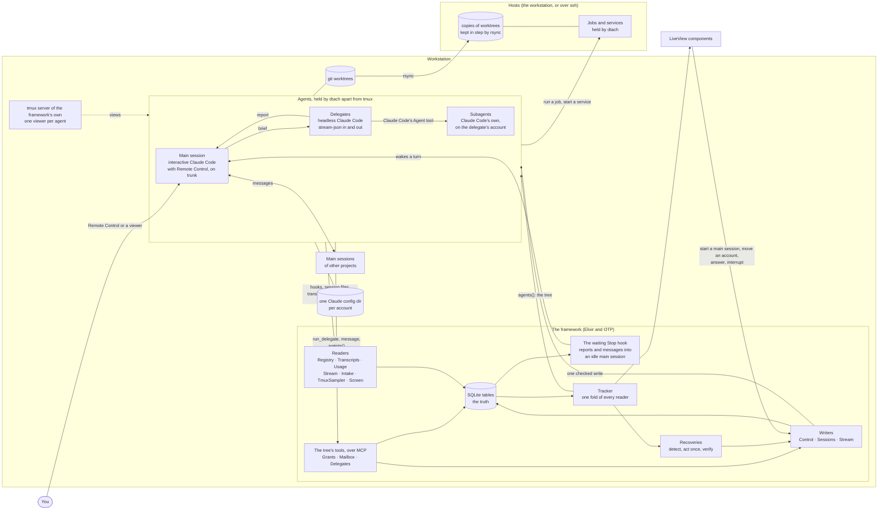
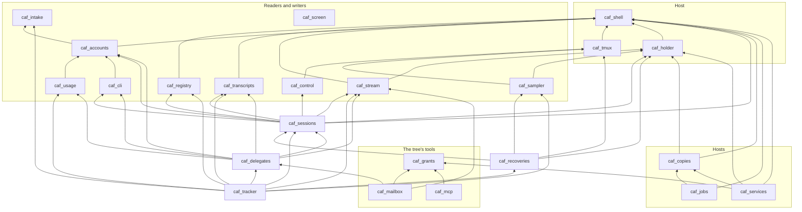

# coding_agent_framework

Run and supervise a tree of Claude Code agents on your workstation, balanced across Claude
accounts, with jobs and services on any machine.

- **Main sessions** are the chats you work in, one per project, on its trunk. Each moves to
  another account with one press, keeping its name and Remote Control, and main sessions of
  different projects talk to each other.
- **Delegates** are real Claude Code sessions a main session starts, on the account with the
  most allowance left, each in its own git worktree. To the main session a delegate acts like a
  subagent: a brief goes in, a report comes back. Inside it, Claude Code's own **subagents**
  delegate further, on the delegate's account.
- **Hosts** run jobs (a test run, a build) and services (a dev server, a database) for agents,
  on an exact copy of the agent's worktree. Agents themselves run only on the workstation.
- **The tree talks along its edges**: an agent talks to its parent and its children, and main
  sessions to each other. Any agent can see the whole tree.
- **Stacked pull requests** (`gh stack`) carry the delegates' work into trunk, and the main
  session pulls it.
- **State for LiveView frontends** follows what really runs, without lag or drift.
- **A TLA+ model**, checked with TLC, describes how tmux, dtach, Claude Code, worktrees, stacks,
  jobs and services fit together. It is written before the code it models.

The words are defined once, in [docs/design.md](docs/design.md#concepts).

## How it fits together

- **Held, not hosted.** Every agent runs under `dtach -n` on the workstation, so it outlives
  tmux, its terminal and the framework. tmux only shows it.
- **Readers, then one writer.** Each reader turns one source (a hook, a session file, a
  transcript, an event log, a tmux sample, a screen) into rows. There is one writer, and each
  write is checked against the target pane before it is sent.
- **Nothing typed to deliver.** A report or a message reaches a main session through its
  waiting Stop hook, which wakes the idle session with the text, so a draft in its box is never
  touched. A session ends by SIGTERM once its session file says it is idle.
- **Addressed by name.** Agents are rows with names; the framework finds every session across
  every account it holds, never by a pid or a socket, so a move to another account hides none.
- **Tables are the truth.** Views and the `agents()` tool read the `Tracker`'s fold of those
  rows, so they never lag or lie. `Recoveries` acts once per broken state and checks that it
  helped.

## Status

Built, each from a checked model in `model/tla/`:
- the base layer, the readers, the writer, `Sessions`, the `Tracker` and `Recoveries`;
- `Delegates`: start, report, resume once after a kill, report a second kill;
- the tree's tools: `Grants`, `Mailbox` and the MCP tools, and the operator (a person or the
  app acting as every main session's parent);
- `Copies`, `Jobs` and `Services` on any host;
- launch options per agent (settings, environment, directories, appended prompt, tools);
- `PreToolUse` held while the app decides, and `PostToolUse` handed on;
- `Screen`, reading a main session's screen from a real release's fixtures.

Next, in order: delivery into a main session by its waiting Stop hook; the move between
accounts, modeled with the end by SIGTERM and a message in flight; interactive delegates; main
sessions; `Mover`; then the mechanisms an app's policies stand on (an idle delegate's watchdog,
admission by load, `Stop` held for the app, a fault ledger, clone copies, an idempotent start),
packaging, and stacks with the LiveView components. The plan and the order of the units are in
[docs/design.md](docs/design.md); each unit's notes are in `docs/build-notes/`.

## The apps

The code is a Mix umbrella, one OTP app per part under `apps/`. An arrow means "uses"; each app
declares every app it uses, directly, and `gate-deps` checks that.

`caf_test` holds the shared test aids and is used only in tests. `caf_example` is an app built
on the others, as an embedding app would be, and uses every one of them. `caf_grants`,
`caf_intake` and `caf_screen` use no other app: the embedding app hands `caf_grants` the tree as
a function, and `caf_screen` reads a screen's text it is given. `caf_mcp` reaches `Delegates`,
`Mailbox` and the `Tracker` through modules the embedding app names.

## Development

Every tool comes from [devenv](https://devenv.sh) 2.x, pinned by `devenv.lock`: Erlang, Elixir,
tmux, dtach, Claude Code, git, gh, TLC with its JDK, and the POSIX tools the tests call.

- Enter the environment with `devenv shell`, or run one command in it with
  `devenv shell -- <command>`.
- Run all the gates with `devenv test`. It checks the tools' versions, runs the git hooks on
  every file, and then runs the gates.
- Run one gate alone with `gate-format`, `gate-compile`, `gate-deps`, `gate-test` or
  `gate-model`. `gate-deps` checks that each app declares, directly, every app it uses.
  `gate-test` leaves out the TLC test; `gate-model` runs it. `mix test` alone runs both.
- Check the tools against the lock with `check-versions`.

Run every command from the umbrella root; `mix test` there runs each app's tests.

`Screen`'s fixtures are a real Claude Code session's screens, captured once per pinned release
by a person with `devenv shell -- bin/capture-screen <home>/accounts/<account>/claude`. It runs
Claude Code in a 120x40 pane on a tmux server of its own, types into the box itself, and asks
you to answer each dialog in a second terminal it attaches to the pane. It scrubs paths and
names (`--name <text>` adds one), prints each line it changed, and writes the screens with a
manifest to `apps/caf_screen/test/fixtures/<version>/`; read them before committing them.
`--dry-run` runs the same steps against a stand-in. No test runs the real Claude Code.

The shell exports each program's store path as `CAF_<NAME>`: `CAF_TMUX`, `CAF_DTACH`,
`CAF_CLAUDE`, `CAF_GIT`, `CAF_GH`, `CAF_SH`, `CAF_BASH`, `CAF_RM`, `CAF_MV`, `CAF_ENV`,
`CAF_KILL`, `CAF_PS`, `CAF_CAT`, `CAF_ECHO`, `CAF_TLC` and `CAF_JAVA`. Tests and
`bin/check-model` run programs only from these paths, never through `PATH`. `CAF_OTP_VERSION`
and `CAF_ELIXIR_VERSION` name the lock's versions, and the tests stop at once when the VM runs
others.

Mix, Hex, rebar3 and the shell history keep their state in `.devenv/state`, not in your home
directory. Hex and rebar3 come from the lock, so nothing is downloaded into it.

Entering the shell writes this repository's own `pre-commit` hook into the common git directory
(`git rev-parse --git-common-dir`), so every worktree shares it. It checks format and American
spelling (`typos`) on the staged files, by absolute store paths, so a plain `git commit` outside
the shell runs it. If `core.hooksPath` points at a global directory, that directory must hand off
to this file when it exists. A `pre-commit` this repository did not write is never replaced.

## License

Apache-2.0; see [LICENSE](LICENSE).
