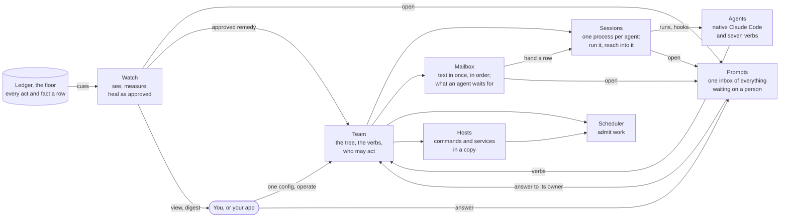
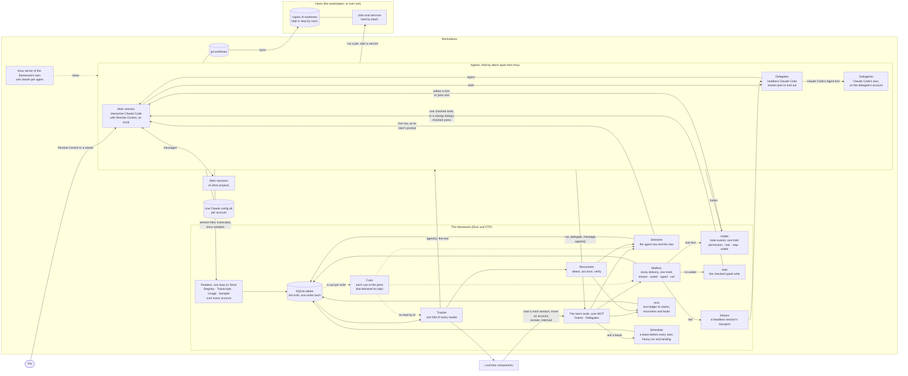

# coding_agent_framework

Run and supervise a tree of Claude Code agents on your workstation, balanced across Claude
accounts, with jobs and services on any machine.

It follows eight rules ([docs/design.md](docs/design.md#principles)):

1. **An agent sees native Claude Code and seven verbs, and every tool call is checked before it
   runs** by the app's policies, corrected rather than refused where it can be.
2. **Every act is a row before it acts, and the ledger is the only truth**; recorded real runs
   are replayed against new code in the gates.
3. **Every protocol is modeled before it is built, and enforced as modeled**: a verb is legal
   only where the spec's transitions allow it.
4. **One writer per row, one interface per box.**
5. **Every outcome is explicit**: ok, refused with a reason, or unknown. No hidden retry, wait
   or fallback.
6. **Nothing by guesswork**: placed by a lease, acted on by a claim, ended by pid and start
   time, answered by its named decider or a person.
7. **Metrics are folds of what is recorded, and healing is bounded**: OTP restarts the
   framework's own crashes within a budget; outside, only remedies a person approved act, once
   per state, capped; everything else is a prompt to a person.
8. **Nothing global, and a crash stays local**: one config, one supervisor, one process per
   agent, host and account; a restart re-adopts from the row, never relaunches.

- **Main sessions** are the chats you work in, one per project, on its trunk. Each moves to
  another account with one press, keeping its name and Remote Control, and main sessions of
  different projects talk to each other.
- **Delegates** are real Claude Code sessions a main session starts, on the usable account
  with the most room, each in its own git worktree. To the main session a delegate acts like a
  subagent: a brief goes in, a report comes back. Inside it, Claude Code's own **subagents**
  delegate further, on the delegate's account.
- **Hosts** run jobs (a test run, a build) and services (a dev server, a database) for agents,
  on an exact copy of the agent's worktree. Agents themselves run only on the workstation.
- **The tree talks along its edges**: an agent talks to its parent and its children, and main
  sessions to each other. Any agent can see the whole tree.
- **Stacked pull requests** (`gh stack`) carry the delegates' work into trunk, and the main
  session pulls it.
- **State for LiveView frontends** follows what really runs, without lag or drift.
- **A TLA+ model**, checked with TLC, describes how tmux, dtach, Claude Code, worktrees, stacks,
  jobs and services fit together. It is written before the code it models.

The words are defined once, in [docs/design.md](docs/design.md#concepts).

## How it fits together

Seven boxes, each a small interface over a modeled inside ([docs/design.md](docs/design.md#the-boxes)).
The chart is the shape units B1 to B13 bring the code to; inside each box the parts run as built.

Every box writes its acts and facts to the `Ledger` beneath them; the chart leaves those arrows
out.

| Box | Does | Interface |
|---|---|---|
| `Team` | the tree, the agents' verbs, who may act; one entry for agents, the operator, the app and the healer | `operate/4`, `tree/2`, `tools/2` |
| `Sessions` | runs each Claude Code session under its own process and reaches into it: start, resume, stop, move, press, hand a line | `start/2`, `steer/3`, `read/2`, `hand/3` |
| `Mailbox` | hands an agent text once, in order, into an ended turn, and fires what it waits for | `send/3`, `subscribe/3`, `read/2` |
| `Prompts` | everything waiting on a person or a parent, at any depth: permissions, questions, dialogs, plans, limits, remedies | `open/2`, `answer/3`, `read/2` |
| `Scheduler` | admits every start, heavy run and landing within capacity and allowance | `request/2`, `read/2` |
| `Hosts` | runs jobs and services on any host, in a copy of the worktree | `run/3`, `serve/3`, `steer/3`, `read/2` |
| `Watch` | shows what runs, measures it, heals only by approved remedies | `view/2`, `metrics/2`, `digest/2`, `remedies/3`, `clear/3` |

Under them, the base: `Shell`, `Holder`, `Store` and the `Ledger` (`claim/2`, `settle/3`,
`record/2`, `query/2`, `subscribe/2`), every act and fact a row, written before it acts, with
a cue.

**An agent's surface** is native Claude Code (its own Bash, background commands and subagents,
intercepted by hooks where the framework must place, lease or drain them) and seven verbs:
`delegate` (with `wait`, `review`, `variants`, `budget`, `fresh`), `message`, `ask`, `look`,
`steer` (its own subtree and services), `wait_for` (never poll) and `serve`. An app adds its own
powers as extensions: a verb, a skill, context at the right moment, events in, and guards.

**The app's surface** is one config and one supervisor in; `operate`, `answer`, `prompts`,
`view`, `metrics`, `digest` and `query` out, and one stream of cues.

## Status

Built, each from a checked model in `model/tla/`:
- the base layer, the readers, the writer, `Sessions`, the `Tracker` and `Recoveries`;
- `Delegates`: start, report, resume once after a kill, report a second kill;
- the tree's tools: `Grants`, `Mailbox` and the MCP tools, and the operator (a person or the
  app acting as every main session's parent), who resumes, answers and interrupts a main
  session;
- `Copies`, `Jobs` and `Services` on any host, and `Hosts`, which finds another host's programs
  when work is placed there, refuses at once a host away or lacking a program, and takes the
  host back without a restart (F-280), finding them on the `PATH` its entry's `env` gives (F-291);
- launch options per agent (settings, environment, directories, appended prompt, tools);
- `PreToolUse` held while the app decides, and `PostToolUse` handed on;
- `Screen`, reading a main session's screen from a real release's fixtures;
- the remodel's first units: `Store`, the SQLite table code every writer shares (R1), and
  `Reader`, the loop every reader runs, with one `Registry` and one `Transcripts` per host over
  every account (R2), and `Holder.Process`, one record of a held program, with a session ended
  by SIGTERM (R3); `Claim` and `Hold` in the model (R4); one hold in `Intake`, with the waiting
  Stop hook (R5); `Delivery` in the model, and the move rewritten with a message in flight
  (R6); and `Mailbox` delivering everything as rows: a delegate's brief, its word to go on and
  its report, by its stream and to a waiting `run_delegate` (R7, part 1), and to a main session
  by its waiting Stop hook, settled by its transcript (R7, part 2);
- `Acts`, one ledger of claims, recoveries and faults, in place of `Grants.Claims` and
  `Recoveries`' table (R10);
- the agent row and the tree in `Sessions` (R9, part 1): one row per agent, main session or
  delegate, with its parent and project; the tree one function of those rows, which `Grants`
  and the `Tracker` both read; and no part reading another's table but through its functions;
- each session's turn state as one function per kind in `Sessions`, starts, resumes, a
  service's fixes and a part's crash as rows of `Acts`, one rule for a term in a column, and
  every writer's `Tracker` source made from its table's metadata (R9, part 2);
- `Cues`, the library's own routing (R11): each part declares the topics it reads, and the
  embedding app hands the declarations to `Cues`, so the order in which the system settles is
  the library's; `Jobs`, `Services` and `Stream` read on their own interval, and no ticker
  sends a made-up topic;
- the `Inlet`, the checked typed write into a main session with no waiter, as `Mailbox`'s
  `typed` transport: the turn and the screen read again in the write's own step, one line with
  the row's uuid, Enter as its own command, and the release each interactive session runs
  recorded at its start (R8);
- `Mover` (R12): a main session or a delegate moved to another account with one act, by the
  operator or a delegate's parent: drained, ended by SIGTERM once idle, its transcript copied
  after its exit, resumed there under its name and session id; what came for it meanwhile goes
  once, to the new process. Its phase is on the agent row, so a restart goes on from it;
- the cleanups the remodel left (F-136): `Mailbox` answers while a write is handed on, the
  readers store a problem by the one rule, an owner's end that ends its services is an act,
  the model is kept on the agent row for any resume, and the hot reads of tables that keep
  every row are indexed;
- the `Scheduler` (F-135), against `Schedule.tla`: a lease ledger on `Store` that every
  delegate's start asks first. A grant is one transaction within each resource's capacity, and
  a waiting landing holds the units it needs from lower classes; four classes, turns between
  modules and aging inside a class; pressure (stall times, or a memory-pressure level) and both
  of an account's windows as gates, the five-hour one now read by `Usage`; a request pressure
  bars waits in the queue and keeps its place, and none is granted once its caller is gone, by
  its death or the deadline it carries (F-276); a lease released
  once, when the owner of the work's row says the work ended, after a restart too; leases and
  refusals on the `Tracker`, and each grant's wait and each refusal as telemetry;
- interactive delegates (F-137): a delegate started `interactive: true` runs Claude Code's
  terminal interface, as a main session does, so a person can attach and type; its brief goes
  in as its start's prompt (the `launch` transport, read from a file into the last argument),
  and its report is the reply to its brief read from its transcript, never a later turn's;
- startup dialogs (F-140), against `Dialog.tla`: an interactive start that stops on Claude
  Code's folder trust dialog or its external imports dialog, which send no hook event and leave
  no session file, is read from its pane; its agent row says `dialog`, with the dialog's
  options and listed paths, and waits on a person through its deadline and a restart, its lease
  held. Nothing answers one on its own: the app may choose kinds through a callback, and a
  person answers by label (`CodingAgentFramework.answer/4`, the operator's `answer_startup`),
  marked first, pressed once and checked on the screen;
- `Jobs` under the `Scheduler` (F-139): every job asks for a lease in the class its caller
  names (a heavy run, a builder's suite, a landing's gates), its row the holder, released once
  `Jobs` read the job's end; a refused job is a row that says why and when to ask again; a
  heavy slot is the first fenced resource, so a start that lands late runs nothing; and a
  landing takes its slot and its project's lock in one gang lease, run by the app through
  `Jobs` (the `run` tool is gone since F-176; an agent's heavy command is its own `Bash`
  under a lease, F-171);
- `Mains` (F-141), against `Checkout.tla`: each project's checkout, the framework's own clone
  of its repository, made once under a temporary name and renamed whole; the pull after a
  landing, fast-forward only and only while the checkout is clean, owed again after a restart
  and held back, visibly, while a person's edit or commit is there; the checkout's reading
  (branch, clean, ahead and behind its remote) for a view; and `start_main`, a main session
  started in the checkout under a free name, its brief its first message, through the
  `Scheduler` and the startup dialogs. The example app declares its projects and main sessions
  through it;
- a main session's end (F-143), against `Team.tla`: the operator's `end_main`, refused while
  a delegate of it has not ended, the session stopped once idle and its agent row ended, so
  every service it owns ends, kept ones too; a main session's resume under a lease of its own,
  a refused start's brief settled, the model a start names, and a stale lock in the checkout
  shown as `locked` until a person clears it;
- the example app run for real (F-146): it starts from a config file checked whole, an
  operator's console in IEx (`bin/caf-example`), an account's login (`bin/caf-login`), and the
  end-to-end run as steps for a person and a main session ([docs/e2e.md](docs/e2e.md));
- what that run needs first (F-147): a new home's first start, an account with no reading
  counting as 0 % used; the hooks' secret kept per home, so a session held across a restart
  keeps its hooks; the text of a reply to the operator; and the operator's answer of a main
  session's held permission request, through `Intake` under a claim;
- the first two mechanisms an app's policies stand on (F-150), against `Delegate.tla`: a
  delegate idle with no report past a bound the app sets is told to its parent once per idle
  state, by a notice in `Mailbox` and never a kill; and a start idempotent per branch, which
  answers the branch's live delegate (`already: true`) and starts again a row with no report
  whose process is gone;
- what a move to a Linux workstation needs first (F-155): a launch's prompt cap per operating
  system (Linux refuses one argument over 128 KiB), a longer first row going as a pointer to
  its file; one agent memory per checkout in the home, each account's linked to it, so a move
  keeps it; a delegate's turn of its own after its report (a background command of its own woke
  it) told to its parent once, as a notice, never as the report, against `Delegate.tla`; every
  tool's state in the home (gh's login, git's config with the app's own commit author and SSH
  signing with the home's own key, ssh's config and known hosts, the XDG directories), with
  `bin/caf-login --gh` and `--git`; and cloudflared in devenv;
- the box contracts and the first of B1 (F-163, F-164, F-167): `Boxes.tla` composing the
  boxes' contracts, a restart per agent that keeps a refused start's seat while its process
  lives, and `Prompt.tla`, one inbox of prompts for every depth of the tree;
- app tools and app metadata (F-154): an app's extension bundle gives its agents tools of its
  own, each prefixed by the bundle's name and listed only to the roles and projects it names,
  each call logged with an explicit outcome; and the app's own keys kept on an agent row;
- a start whose caller gave up never runs later (F-166, against `Delegate.tla`): a start
  carries its caller's deadline, and one taken past it is refused and starts nothing;
- gh's token kept as a file in the home, and every program `bin/caf-login` runs taken from
  devenv (F-168);
- the `Stop` hold (F-157 part A, against `Intake.tla` and `Prompt.tla`): the app decides at each
  turn's end, Claude Code's cap of eight blocks in a row becomes a person's prompt, a pause per
  agent and per project holds a turn's end, and of a session's waiters the newest is kept;
- the app's surface's start (F-169): `CodingAgentFramework.child_spec/1` builds the whole tree
  from one config with its extensions and hooks, the example app now a thin user of it; a
  `PreToolUse` callback that corrects a call (`updatedInput`, `additionalContext`) rather than
  refuses it; and a home whose path has a space;
- for an app that starts its builders through the operator (F-170, against `Delegate.tla` and
  `Delivery.tla`): the operator's start takes the tool's options; a start whose lease is queued
  answers at once with its place, and its outcome reaches the parent once, as a notice; every
  report, reply and notice names its sender; and the operator's forced end of a session a
  delivery can never settle, its rows in flight settled unknown;
- `USER` in every launch on macOS, which names the Keychain item that holds an account's login
  (F-173, measured);
- an ask withdrawn by the app or the operator, settled once against an answer (F-172, against
  `Prompt.tla`); the pointer line naming its sender and its file's path in backticks; a forced
  end's rows settled by `Mailbox` itself, after a restart too; names refused before any row when
  their socket would not fit under the home; and `Mains`' start carrying its caller's deadline;
- heavy commands taken transparently (F-171, against `Schedule.tla`): an agent's `Bash` call
  that matches the app's heavy list is rewritten into `caf-run`, which waits for a lease with
  one `queued` line, runs the command and releases the lease once on any end; the `Stop` count
  reset at a turn's end, as measured; pressure cues, macOS's pressure level by default, `Jobs`
  and `Copies` on the `Tracker`, and a headless delegate busy while its own background command
  runs;
- `subscribe/2` on the app's surface (F-174): an app's own processes get the tree's cues on the
  topics they name, found by the instance's name in its own `Registry`, removed when they exit,
  and never able to slow or break the tree;
- an app's conversations moved onto a new host at once (F-156, against `Checkout.tla`): each
  checkout named by its repository (or the project's `dir:`), so `@../other_repo/` imports
  resolve, an older checkout renamed once no session runs in it; and `bin/caf-import`, which
  copies an existing config directory's conversations, memory and settings into an account and
  makes each named conversation a stopped main session the app resumes;
- every topic a part writes subscribable (F-176), each part declaring its writes beside its reads;
  a subscription that answers its tree's pid, so an app subscribes again after a restart of the
  whole tree; the operator's tools listed to no agent; the `run` tool gone, an agent's heavy
  command its own `Bash`; and every subscriber of a topic reached, however many there are;
- a resume on its row's account (F-177, against `Move.tla`): a stopped main session, an
  imported one's included, resumes where its conversation is, and on another account only
  when its own is refused, after a copy of the conversation as a move makes; and an import
  refused while a Claude Code run by hand on the account or the source may run;
- one inbox of prompts (F-179, B6's first part, against `Prompt.tla` and `Boxes.tla`): a held
  permission request, a `Stop` held at the cap, a startup dialog and an agent's ask read in one
  place (`CodingAgentFramework.prompts/2`) as one function of their owners' rows, cued on
  `prompts`, and answered once through `answer/4`, which hands the choice to the part that
  owns it; a delegate's parent told once that it waits; the operator's `answer_startup` and
  `withdraw` through the same inbox;
- the first guards an app drops when it runs its agents on the framework (F-180): every
  background `Bash` command runs with its stdin at end of file, whatever the app's callback
  answers, so a program that reads stdin never waits for ever; a session on a startup dialog
  reads `dialog` by its turn and in the tree, never idle; and `bin/capture-screen` captures the
  exit dialog, for its reading;
- the healer on an allow-list (F-182, B8 and B7's start, against `Heal.tla` and `Boxes.tla`):
  each symptom state a fact in the `Watch` (`symptoms/2`, cued on `watch`) before anything
  acts on it; `Recoveries` acts only by the remedy the config's list names for its kind, under
  a cap per bound, once per state, and asks a person (a `remedy` prompt) for the rest; a remedy
  whose verify failed leaves the list, which only the operator widens (`remedies/2`); and an
  asked background command corrected too, its prompt showing the corrected call;
- the first remedy on that shape and one clear (F-183, against `Remedies.tla`): a main session
  whose process exited by itself is resumed once per absence through `Mains`, and a second
  absence within the bound is asked (`AbsentMains`); a `remedy` prompt's answer is the person's
  clear of its state (`Watch.clear/3`), and `Recoveries.clear/2` is gone;
- a background command that outlives its delegate's report (F-184, against `Remedies.tla`): the
  report is taken at the result Claude Code writes while the command runs, and the turn the
  command's end begins is never a second report; a command whose group used no CPU time for a
  bound after the report is ended by its record, on Linux (`StuckBackgrounds`); and a tool call
  with no hook row of its session within a bound is shown as `hooks_silent` (`HooksSilent`);
- usage limits and the config (F-185 to F-193, against `Limit.tla` and `Move.tla`): a limited
  agent shown, its menu stopped, its word to go on sent once per limit, a delegate moved past
  `move_after` and a main moved only by a person's answer, a headless move with nothing due
  resumed with its own word, and the limited agents by account in the `Watch`; every setting an
  app passed by hand a config key; and a person's claim closed by the healer's restart;
- what an app's move onto the tree wired by hand (F-195): a tree with `agents: false` that runs
  only leases, `agent_rows/1` reading the rows by the config, `tool_hooks` as `{module, opts}`,
  and a start right after a kill waiting up to `restart_wait` for the old tree's exit;
- a `PostToolUse` that waits (F-197, against `Hold.tla` and `Intake.tla`): the app's
  `post_tool_use/3` may answer `{:replace, response}` within the tool deadline, sent as Claude
  Code's `updatedToolOutput` in the tool's own response shape (measured on 2.1.322: a string is
  ignored), and past the deadline the call goes on unchanged, recorded;
- the metrics' first rows (F-194, B7): every answer through `answer/4` is an `Acts` row (who,
  the choice, when the prompt opened and when it was answered), and a person's typed input and
  interrupts are rows of their own (`Interventions`), each read from a fact, never a guess;
- a delegate's effort (F-200): `start_delegate` and `run_delegate` take `effort`, passed as
  `claude --effort` and kept in the delegate's row for its resumes, and every delegate starts
  without Claude Code's git instructions (`includeGitInstructions: false`) unless its settings
  say otherwise;
- any numbered menu on a main session's screen (F-198, against `Menu.tla`): `Screen` reads a
  menu no rule names by its shape and footer, `Sessions` keeps it on the running row from a read
  of the pane, and the inbox shows it as a `dialog` prompt with its options and `esc`, no default
  and no deadline, pressed only by a person's answer with the marker read back before Enter; and
  a dim prompt suggestion in the input box is read as no text;
- what an app's first run on the tree found (F-201): a tool event carries Claude Code's `cwd`, an
  agentless config needs only what it reads, `agent_rows/1` takes the instance's name, an answer
  that is not JSON is a pass with its problem recorded, and `post_tool_use/3` may add context to
  the call it is about (`{:context, text}`, measured on 2.1.322);
- one reading of the metrics (F-199, B7): `metrics/2` counts builders started, reported,
  stalled, late, killed and restarted, usage-limit stalls and moves, prompts and their time to
  answer, recoveries and a person's interventions (a viewer attached among them), as a pure fold
  of the rows cut by UTC day, ISO week or all, each rule in its `@doc`; a fact no row holds yet is
  listed as `unread`, never guessed;
- a start refused at a limit waits as its owner's row (F-196, against `Limit.tla`'s `Starts`): a
  delegate's or a main's start or resume that finds every usable account limited is written
  `waiting` with the soonest reset, shown in the inbox as a `limit` prompt answered `wait` (its
  default) or `leave`, and at the reset picks again and asks for its lease under its own request
  id; and a `remedy` answered `act` shows `answering` until its act's row ends;
- no message into a delegate's own turn (F-204, against `Remedies.tla`'s `NoMessageIntoOwnTurn`):
  a background command's end reads the delegate busy until the turn it begins has started and
  ended, bounded by `wake:` (30 s), so a parent's message waits through that turn;
- the loose ends of F-196 to F-201 (F-203, against `Heal.tla` and `Remedies.tla`'s waits): an
  answered act whose state passed leaves the inbox, `run_delegate` of a waiting start answers at
  once, a waited resume is settled from its row's end into the fault ledger, a start's menu is a
  startup dialog, and an `env` without `path` is refused for every tree;
- a service's socket named by a short key of its name, so every allowed name fits a home of up to
  69 bytes, and a login prompt's id naming its refusal (F-205);
- the facts the metrics could not read (F-202): how a delegate's report was taken
  (`taken_by`), a hold's open time (`held_at`), a kill seen (an `Acts` fact), a delivery time
  (`delivered_at`) and each prompt's open, each written once when it happens, so `metrics/2`
  leaves nothing `unread`;
- an app says which accounts are usable (F-207): `usable: {module, opts}`, asked after the
  framework's own login check by every part that picks an account, a refusal carrying the app's
  reason; and a home too long for services refused at the start;
- every onboarding menu of a start reaches a person (F-206, against `Dialog.tla`'s menus): each
  menu a start shows is its own read, prompt and press, and a person's leave of a waited resume is
  their clear of the absence, so they are not asked twice;
- a delegate's resume never goes on an account the app flags (F-209, against `Move.tla`'s
  `NoResumeOnRefused`): it asks `usable:` for its own account, moves to the account the pick finds
  when refused, and stays down with the app's reason when none is usable; and a tree without
  agents refuses the keys only an agent's part reads;
- a move's resume reads the app's flag again (F-210, against `Move.tla`'s `MoveBack` and
  `Stranded`): a target flagged during the drain sends the move back to its own account, or
  leaves the row down when that one is flagged too;
- a move's resume has a deadline (F-211, against `Move.tla`'s `ResumeEnds`): a flag check that
  stays unknown is asked again until `resume_wait` (5 min), then taken as a refusal, so every
  move's resume ends moved, back or left down; and every other unknown of that resume (the
  app's launch, the word, the first line) under the same deadline (F-212);
- the agents' instructions say to compile with `--force` in both environments after merging
  `main`, since a stale struct type in `_build` fails the gates (F-213);
- a home keeps its kind (F-214): the first start on a home records in its database whether the
  tree runs agents, a tree of the other kind is refused `{:home_kind, recorded}` before any part
  starts, a home that ran before the mark and holds agent rows is marked `agents`, and
  `home_kind/1` reads the kind without starting a tree;
- a home belongs to one tree at a time (F-215): a tree takes the home's lock before it opens
  anything in it and holds it for its life, a second start on a held home, from this VM or
  another, is refused `{:home_held, holder}` at once, and a holder's death gives the lock back
  with no person's step;
- a busy store answers by the clock (F-216): a statement that meets another connection's write
  lock waits at most 2 s by the monotonic clock, then `open`, `write` and the reads answer
  `{:refused, {:sqlite, :busy}}` and a statement raises `Store.Busy`, within 100 ms of the bound;
- every bounded wait reads the clock (F-217): the waits that counted sleeps, all in a host's
  shell (`Holder.Process`'s `read` wait and `await_dead`, `Services`' offset wait, `caf-run`'s
  asks with no answer), now run one sleep of the whole bound beside their reads and stop when
  it ends;
- the last waits with no bound have one (F-218): one `caf-run` ask is cut by curl at the plug's
  `:wait` and 5 s, and counts as no answer; the waiter stand-in's hook run ends, with its
  group, after 5 s; and a deadline that lives in one call (`Holder.Process`'s end,
  `Services.wait/4`, `Jobs`' read retries) is on the monotonic clock, while a row's stays on
  OS time to outlive a restart;
- the tools offer a delegate's effort levels as an `enum` (F-219): `MCP.start_link/1` takes
  `efforts:`, a required list of strings, and the surface hands it `ClaudeCLI.efforts/0`, so a
  client sees and checks the levels of `start_delegate`'s and `run_delegate`'s `effort` before
  the call; `Delegates` still refuses any other;
- a headless delegate's permission requests reach the inbox (F-221): its launch passes
  `--permission-prompt-tool stdio`, without which the real Claude Code denies the tool at once
  and sends no `can_use_tool`, and the stand-in now does the same, so a test catches a launch
  that loses the flag, and an answered request settles on the answer Claude Code echoes back;
- one setup command (F-220): `bin/caf-login --setup <home|config.json> [account …]` logs each
  account in, runs Claude Code's first run as `claude /exit` so it closes by itself, then logs gh
  in with the signing-key scope and adds the home's key. Every step checks first and skips what is
  done, so no device login or key is repeated, and `bin/caf-example` fetches stale deps itself;
- the store's bound tests allow 500 ms past the 2 s bound, which holds on a loaded host (F-224);
- a headless session's viewer, `tail -F` of its log, ends with the session (F-225);
- a restart no longer takes the tree down when an interactive delegate's report was taken
  (F-222): `Delegates` read the turns after the report with a clause that matched only an
  unchanged state, and a restart's first read changes it;
- `--setup` refuses when it has no terminal, and the example console sets the run's aliases
  itself (F-226);
- each role's permission mode is pinned by the config (F-227): `auto` for a main session and an
  interactive delegate, `manual` for a headless one, whatever the account's own default;
- a permission dialog no reading names reaches a person as a menu (F-228), and so does Claude
  Code's own question until B10 intercepts it (F-230);
- the end-to-end run's steps 1, 2, 3, 5 and 14 run as a suite against the real Claude Code,
  `mix test.real`, outside the gates (F-223); it found a project taking another's checkout;
- a project never takes another project's checkout (F-229): a path another project's row holds
  is refused, and a directory whose `origin` is another repository reads `failed`.
- the tree names each session's transcript and each subagent's `agent_id` (F-234);
- an end reaches a start that waits on its dialog (F-231): `end_main` and a stop press the trust
  dialog's `No, exit`, or send SIGTERM, and end it; a fix refused before it acted frees its
  state in `Acts`, so the next fix of that state is taken.
- the operator reloads an interactive agent's plugins (F-233): `Operator.reload_plugins/2`
  types `/reload-plugins` through the `Inlet`, checked as a typed message is, and reads its
  result line; each reload is an act in `Acts`, and a headless delegate is refused.
- a reload reaches an idle session whose waiter holds its turn (F-241): the waiter is passed
  and the reload typed once, or it is refused `message_due` while a row to it is open.
- the tree shows each agent's tool calls, and the one it runs now (F-235): read from its
  transcript, with no hook post per call; `Tracker.tool_calls/3` answers the recent ones.
- the interactive stand-in makes its own `sessions/`, answers `auth status` and writes 2.1.322's
  session file as its screen changes, so a test runs a main session on the whole example tree
  (F-232).
- the app's tool hooks take a session's start (F-236): `session_start/3` answers a context the
  model reads with the first prompt, through a `command` hook, since Claude Code runs no `http`
  hook on `SessionStart`; the framework's own `http` one, which never posted, is gone.
- the gates hold on a loaded host (F-238): a test's bound on work that load lengthens is scaled
  by the load its suite read at its start, the `Inlet`'s read back of a press takes `see:` per
  instance, `bin/check-model` prints the load beside each time and judges the 30 s rule only
  under a load below the core count, and TLC runs in `gate-model` alone.
- the real suite checks what F-230 and F-233 modeled (F-239): a reload, Claude Code's own question
  as a menu, and an interactive delegate (step 4), each a test of its own that records the
  screens it meets; run on a logged-in setup, it found the reload refused under a waiter (F-241)
  and a trust press read back too soon under load (F-242).
- a message to an idle interactive delegate whose typed line the box cannot hold no longer
  waits for ever after a restart (F-240): a wake line, typed once, brings the waiter that
  carries it; with none within a bound it is `undelivered`, its sender gets a notice, and the
  rows behind it go in. `look` marks an interactive agent's events `not followed (interactive)`.
- a dialog press holds on a loaded host (F-242): the tree's `Inlet` reads back at the config's
  `press_see` (10 s by default), each bound that waits on a press is derived from it, and a
  press whose pane closes ("No, exit") is answered as soon as the pane is gone.
- a message can be sent again safely (F-250): `message` takes an optional `key`, scoped to its
  sender; a second send under it stores no row and answers the first id, and an `unknown`
  answer names the key. The MCP's step bound is its `:step` option, 5 s by default.
- a press's bounds have one owner (F-245): the `Inlet` alone takes `see:`, its press bound
  counts the six tmux commands a press runs at their own bound, `Sessions` asks it that bound,
  and each caller of a press asks `Sessions` its call's, so none is a second fixed number.
- a stop's exit press is bounded by the press chain (F-248): a stop waits its steps plus the
  press's wait, derived, and a caller's own deadline cuts the press and answers unknown.
- a press's wait in the `Inlet`'s queue is bounded (F-249, `Inlet.tla`): each call carries its
  deadline, a press starts only while its bound fits before it and is otherwise answered
  `{:refused, :busy}` untouched, the `Inlet` runs each call in a task so it answers meanwhile,
  and `Sessions`' ask for the press bound never waits in the queue.
- a subagent's own transcript is read, so its tool calls show (F-237): `Transcripts` lists each
  session's `subagents/` directory on every read and folds each file that changed; a running
  subagent has its `agent_id` from its file's meta, and its own `tool` in the tree; a file
  whose subagent finished before its first read is not read, and a first read takes at most
  a file's last 1 MB.
- a transcript's first read is bounded (F-244): a session with no stored fold is read from at
  most its main file's last 1 MB, from a whole line, and its fold and its tree row say
  `partial`; a subagent started before that part keeps its row, its type and description from
  its file's meta. A rewritten or returned main file is read the same way. Landing it refolds
  each stored fold once, bounded, so a long session's old history is not kept.
- the real suite runs steps 12 and 13 and records each press (F-243): a headless delegate's
  background command waking it in a turn of its own, with the wake gap checked and recorded; an
  absent main resumed once by the operator; and, for every dialog or menu press, the screens
  before, during and after it, with its label and answer.
- a test's helper process is defined before the test that starts it (F-247), so a loaded host
  cannot start the test before its helper exists.
- `Tracker.tool_calls/3` gives each call `duration_ms`, its own time from the `PostToolUse` or
  `PostToolUseFailure` hook (F-253), beside `ms`, the transcript's result less its call; `Intake`
  now always writes both hooks' rows and sweeps them after `tool_rows_keep:` (7 days).
- a test lists only the stand-in's session files (F-251), not the `.tmp` file the stand-in
  renames into one.
- a trust press on a fresh start holds (F-246): Claude Code draws a dialog again about 150 ms
  after its first draw and sets its selection back, so the `Inlet` sends no key until the
  dialog has read the same for 1 s (`Press.tla`).
- a start has one form (F-252): the `Registry` turns a session file's `procStart` in Linux's
  form, a start in clock ticks, into the `ps -o lstart=` text as it reads the file, so a Linux
  main is confirmed, and its stop and end signal it.
- a fix answers on a busy host (F-261): cues queued while `Delegates` settles run one settle, a
  finished delegate's own turns are read again only once its transcript has grown, and
  `Interventions` and `HooksSilent` take one check for a burst of cues, so a stop's state read no
  longer waits past its bound.
- `bin/caf-login` makes the home's `git` folder before its gh step (F-262): `gh auth login` writes
  git's global config, which the home holds.
- the tree shows each agent's background commands (F-259, `Background.tla`): a count, since
  when, and its source (a headless delegate's stream; an interactive session's newest `Stop`
  input, emptied by a later `idle` session file), or `unknown`, never none; a host's process
  groups read beside it, `unknown` on macOS.
- a worktree the framework makes is trusted before Claude Code starts in it (F-255): an
  interactive start marks the tree's real path in its account's `.claude.json`, under Claude
  Code's own lock (`Trust.tla`), so no trust dialog shows; a mark refused leaves the dialog to
  the press.
- `bin/caf-login`'s gh step sets up git's credential helper when a kept login has none, and
  its check reads it in the home's git config (F-263).
- an interactive delegate's reply to a message is stored (F-257): `Delegates` reads each ended
  turn's marks from its transcript, and `Mailbox.answered/4` stores the turn's reply under the
  message's key. A turn a message was queued into is never told as its own (`Reply.tla`), and a
  `<task-notification>` prompt is never a person's typing.
- the inbox reads closed prompts and keeps a hidden mark (F-254): `answered/2` pages the prompts
  that closed, each with its choice or withdrawal reason, who answered and when, from the ledger;
  `hide/3` and `unhide/3` set an open prompt aside, still answerable, as a fact in `Acts`.
- an app reads an agent's conversation through the facade (F-260):
  `CodingAgentFramework.conversation/3` answers its prompts, replies, tool calls, notices,
  interrupts and system lines as entries, a cursor for what comes next, and the rows queued for
  it; the host's `Transcripts` reads the file, bounded, through that host's shell. A first read
  answers the newest entries from the file's end, an older cursor pages back, and `queued` shows
  Claude Code's own queue beside the framework's (F-267).
- an app reads what holds the machine through the facade (F-266): `CodingAgentFramework.holds/2`
  answers the unreleased leases and the last released ones, each job under its lease with its
  command, copy and log path, the copies, each resource's held units and the pressure. A job's
  row now keeps its command.
- an app reads agent rows by session id or by a key in their `meta`, each with its turn state
  from the tree (F-265): `agent_rows/2` filters in the store's query, the session id by an index.
- a held session outlives a stop of the app's systemd unit (F-274): a host whose `scope` is
  `:systemd_user` starts each `dtach -n` holder and the tmux server in a `systemd-run --user
  --scope` unit of its own, out of the app's cgroup, and refuses a start whose scope fails.
- the gates pass on a Linux host (NixOS) as on macOS (F-272): the screen stand-in redraws when
  its size changes, as Claude Code does, and the tests no longer assume macOS paths, signals or
  timing.
- a typed row is delivered by its line in the transcript, its turn ended or not (F-277): one
  that waited for an ended turn stayed `sending` when the app's answer to the Stop hook went on
  with the turn, and every row behind it waited.
- Remote Control follows the kind (F-275): only a main session has it, never a delegate, even an
  interactive one; a main takes a `title:` at its start and resume, which its launch gives
  `--name` and `--remote-control` while its agent name stays its address.
- pressure measured on the Linux workstation (F-273): memory `full` reads `severe` over 1% of a
  span, samples that flip between `ok` and `high` take `severe` down, a clock set back starts a
  new span, and a pressure refusal carries the reading that set the level.
- a launch row is read in the session its start made (F-282): a new start of an agent whose row
  named an earlier session read that session's offset in the new transcript, never found the
  brief's line, and kept the row `sending`, so the parent's stop was refused `open`.
- a turn's end shows in the tree within a second of its session file (F-281): `Registry` reads
  again `follow` ms (1 s) after a read that saw a turn in flight, so a tree with a long
  `interval` no longer shows a main `working` until some other part happens to read the files.
- a typed row is pasted whole, any number of lines up to 8 000 bytes, into a tmux buffer named
  for its row, and settled by its transcript line (F-279): a message arrives as a message, not
  as a due file, which serves only the rows past that bound.
- each test that starts a tree takes an instance name of its own (F-283), so two such tests in
  one VM no longer refuse each other `{:instance_running, "t"}`.
- the offer to set up auto mode is off in every session's settings (F-285): `skillOverrides`
  carries `"auto-mode-setup": "off"`, over the app's entry for that skill, with the app's other
  entries kept, so a delegate's messages no longer wait behind the offer each turn.
- a start whose launch call timed out no longer blocks its branch (F-284): its caller undoes the
  mark it never heard of, a brief marked for a start that never wrote its agent row ends at that
  start's deadline, and a delegate's new start ends an earlier start's brief left queued, which
  the launch would have carried in its own brief's place.
- an interactive delegate's report is no longer held behind a background command (F-269): its
  turn ends at Claude Code's turn-end line after the reply, whatever its session file reads,
  and a fix whose state read times out is an `unknown` act of its own in the ledger.
- a paste carries bracketed paste's markers in its own buffer (F-287), so a multi-line message
  is one submit even in a pane that attached under dtach after its program asked for the mode.
- `bin/check-model` runs TLC on every core only while the load is under half the cores, and on 2
  workers otherwise (F-290), so a model check on a busy shared host leaves its cores to others.
- a `Mailbox` call answers within its 5 s on a loaded host (F-289): a settle pass reads the
  transcripts and the other parts in a task, and applies what it read to each row as it is
  then, so a slow read no longer holds `message`, `launch/4` or `ended/3`.

The remodel (F-115, taken in F-116) is done. F-162 designed the outside: the eight rules, the
seven boxes, the agents' seven verbs, one process per agent under OTP, one inbox of prompts,
metrics and bounded healing, extensions and the app's surface. Next, the boxes' units B1 to B13
with F-157's heavy commands among them, then the rest
of the mechanisms an app's policies stand on (`Stop` held for the app, clone copies),
packaging, and stacks with the LiveView components. The plan and the order of the units are in
[docs/design.md](docs/design.md); each unit's notes are in `docs/build-notes/`.

## Inside the boxes

The chart below shows the parts as the remodel (F-115, units R1 to R12) left them, each
mechanism once, in the part that owns it.

- **Held, not hosted.** Every agent runs under `dtach -n` on the workstation, so it outlives
  tmux, its terminal and the framework. tmux only shows it.
- **Readers, then one writer per table.** Each reader turns one source (a hook, a session file,
  a transcript, an event log, a tmux sample, a screen) into rows, with one shared loop. Each
  table has one writer, and a part reads another's state only through that part's functions.
  The one typed write is checked against the target pane before it is sent.
- **Each mechanism once.** Everything handed to an agent is one row in `Mailbox`, with one mark
  and settle whatever the transport; every hook that waits is one hold in `Intake`; every claim,
  recovery and fault is one row in `Acts`; every agent, main session or delegate, is one row in
  `Sessions`, and the tree is a function of those rows.
- **Nothing typed to deliver.** A report or a message reaches a main session through its
  waiting Stop hook, which wakes the idle session with the text, or has Claude Code queue it into
  a turn still running, so a draft in its box is never touched; the transcript confirms it. Only a
  session with no waiter gets a typed line, from the `Inlet`, into an ended turn with an empty
  box. A session ends by SIGTERM once its session file says it is idle.
- **Addressed by name.** Agents are rows with names; the framework finds every session across
  every account it holds, never by a pid or a socket, so a move to another account hides none.
- **A lease before every start.** Every agent start, heavy run and landing asks the
  `Scheduler` first: granted, queued with one answer to follow, or refused with a reason and a
  retry time, never a failed run. Leases are rows, released once, when the work they admit ends.
- **Tables are the truth.** Views and the `agents()` tool read the `Tracker`'s fold of those
  rows, so they never lag or lie. `Recoveries` acts once per broken state and checks that it
  helped.

### The apps

The code is a Mix umbrella, one OTP app per part under `apps/`. An arrow means "uses"; each app
declares every app it uses, directly, and `gate-deps` checks that. The chart shows the apps as
built. Each belongs to one box: `Prompts` holds `caf_prompts` (B6, F-179), the inbox that
reads and answers the requests whose mechanisms stay in `caf_mailbox`, `caf_intake` and
`caf_sessions`; `Sessions` holds
`caf_sessions`, `caf_mover`, `caf_stream`, `caf_inlet`, `caf_screen`, `caf_intake`,
`caf_registry`, `caf_transcripts`, `caf_sampler`, `caf_cli`, `caf_accounts` and `caf_tmux`;
`Mailbox` holds `caf_mailbox`; `Team` holds `caf_delegates`, `caf_mains`, `caf_grants` and
`caf_mcp`; the `Scheduler` holds `caf_scheduler` and `caf_usage`; `Hosts` holds `caf_copies`,
`caf_jobs`, `caf_services` and `caf_runs`; the `Watch` holds `caf_tracker`, `caf_recoveries`
and `caf_watch` (the symptom record and the allow-list, F-182).
`caf_shell`, `caf_holder`, `caf_store` and the `Ledger`'s `caf_acts` and `caf_cues` are the
base under every box. From B2, a call into a
box from outside it goes only through the box's own module.

```mermaid
flowchart BT
  subgraph host_layer["Host"]
    shell[caf_shell]
    tmux[caf_tmux]
    holder[caf_holder]
    store[caf_store]
    cues[caf_cues]
    tool_home[caf_tool_home]
  end
  subgraph io["Readers and writers"]
    registry[caf_registry]
    transcripts[caf_transcripts]
    intake[caf_intake]
    accounts[caf_accounts]
    usage[caf_usage]
    cli[caf_cli]
    inlet[caf_inlet]
    stream[caf_stream]
    sampler[caf_sampler]
    screen[caf_screen]
    acts[caf_acts]
  end
  sessions[caf_sessions]
  recoveries[caf_recoveries]
  watch[caf_watch]
  tracker[caf_tracker]
  delegates[caf_delegates]
  mover[caf_mover]
  mains[caf_mains]
  scheduler[caf_scheduler]
  subgraph team["The tree's tools"]
    grants[caf_grants]
    mailbox[caf_mailbox]
    mcp[caf_mcp]
  end
  prompts[caf_prompts]
  subgraph hosts["Hosts"]
    copies[caf_copies]
    jobs[caf_jobs]
    services[caf_services]
    runs[caf_runs]
  end

  tmux --> shell
  tool_home --> shell
  holder --> shell
  registry --> shell
  registry --> holder
  transcripts --> shell
  accounts --> shell
  accounts --> intake
  usage --> accounts
  cli --> accounts
  inlet --> tmux
  inlet --> screen
  stream --> shell
  stream --> holder
  sampler --> tmux
  sampler --> holder
  sessions --> shell
  sessions --> holder
  sessions --> registry
  sessions --> accounts
  sessions --> cli
  sessions --> tmux
  sessions --> stream
  sessions --> transcripts
  sessions --> intake
  sessions --> inlet
  recoveries --> tmux
  recoveries --> holder
  recoveries --> sampler
  recoveries --> sessions
  recoveries --> acts
  recoveries --> watch
  watch --> store
  tracker --> store
  tracker --> sessions
  sessions & delegates & services --> acts
  delegates --> accounts
  delegates --> cli
  delegates --> usage
  delegates --> stream
  delegates --> sessions
  delegates --> transcripts
  delegates --> mailbox
  delegates --> registry
  delegates --> scheduler
  jobs --> scheduler
  scheduler --> store
  mailbox --> sessions
  mailbox --> grants
  mailbox --> stream
  mailbox --> intake
  mailbox --> transcripts
  mailbox --> accounts
  mailbox --> inlet
  mailbox --> registry
  mailbox --> cli
  mailbox --> shell
  mover --> sessions
  mover --> mailbox
  mover --> accounts
  mover --> usage
  mover --> transcripts
  mover --> acts
  mains --> shell
  mains --> accounts
  mains --> usage
  mains --> stream
  mains --> sessions
  mains --> mailbox
  mains --> scheduler
  mains --> store
  mains --> transcripts
  mains --> acts
  mcp --> grants
  mcp --> acts
  prompts --> intake
  prompts --> sessions
  prompts --> mailbox
  prompts --> watch
  copies --> shell
  copies --> holder
  jobs --> shell
  jobs --> copies
  jobs --> holder
  services --> shell
  sessions & delegates & stream & mailbox & intake & jobs --> store
  services & copies & mcp & acts --> store
  registry & transcripts & usage & sampler --> store
  services --> holder
  services --> grants
  services --> copies
  runs --> shell
  runs --> holder
  runs --> scheduler
```

`caf_test` holds the shared test aids and is used only in tests. `caf_surface` is the app's
surface (`CodingAgentFramework.child_spec/1`, one config, one supervisor) and uses every other
app; `caf_example` is an app built on it, as an embedding app would be. `caf_cues`,
`caf_grants`, `caf_intake` and `caf_screen` use no other app: the embedding app hands `caf_cues`
each part's declaration of what it reads and `caf_grants` the tree as a function, and
`caf_screen` reads a screen's text it is given. `caf_mcp` reaches `Delegates`,
`Mailbox`, the `Tracker`, the `Mover`, `Prompts` and `Mains` through modules the embedding app
names.

## Development

Every tool comes from [devenv](https://devenv.sh) 2.x, pinned by `devenv.lock`: Erlang, Elixir,
tmux, dtach, Claude Code, git, gh, rsync, ssh and ssh-keygen, cloudflared (for a tunnel an app or a
person configures; the framework never runs it), TLC with its JDK, and the POSIX tools the tests
call. Every program the framework, a launch, a job or a test runs is devenv's, by its `CAF_<NAME>`
path, and every program's data stays in the framework home, so a home moves whole to another
machine that has nix.

- Enter the environment with `devenv shell`, or run one command in it with
  `devenv shell -- <command>`.
- Run all the gates with `devenv test`. It checks the tools' versions, runs the git hooks on
  every file, and then runs the gates.
- Run one gate alone with `gate-format`, `gate-compile`, `gate-deps`, `gate-test` or
  `gate-model`. `gate-deps` checks that each app declares, directly, every app it uses.
  `gate-model` runs TLC through `bin/check-model`; no test runs it (F-238).
- Check the tools against the lock with `check-versions`.

Run every command from the umbrella root; `mix test` there runs each app's tests.

`Screen`'s fixtures are a real Claude Code session's screens, captured once per pinned release
by a person with `devenv shell -- bin/capture-screen <home>/accounts/<account>/claude`. It runs
Claude Code in a 120x40 pane on a tmux server of its own, types into the box itself, and asks
you to answer each dialog in a second terminal it attaches to the pane. It scrubs paths and
names (`--name <text>` adds one), prints each line it changed, and writes the screens with a
manifest to `apps/caf_screen/test/fixtures/<version>/`; read them before committing them.
`--dry-run` runs the same steps against a stand-in. No test runs the real Claude Code.

The shell exports each program's store path as `CAF_<NAME>`: `CAF_TMUX`, `CAF_DTACH`,
`CAF_CLAUDE`, `CAF_GIT`, `CAF_GH`, `CAF_SH`, `CAF_BASH`, `CAF_RM`, `CAF_MV`, `CAF_ENV`,
`CAF_KILL`, `CAF_PS`, `CAF_CAT`, `CAF_ECHO`, `CAF_TLC` and `CAF_JAVA`. Tests and
`bin/check-model` run programs only from these paths, never through `PATH`. `CAF_OTP_VERSION`
and `CAF_ELIXIR_VERSION` name the lock's versions, and the tests stop at once when the VM runs
others.

Mix, Hex, rebar3 and the shell history keep their state in `.devenv/state`, not in your home
directory. Hex and rebar3 come from the lock, so nothing is downloaded into it.

Entering the shell writes this repository's own `pre-commit` hook into the common git directory
(`git rev-parse --git-common-dir`), so every worktree shares it. It checks format and American
spelling (`typos`) on the staged files, by absolute store paths, so a plain `git commit` outside
the shell runs it. If `core.hooksPath` points at a global directory, that directory must hand off
to this file when it exists. A `pre-commit` this repository did not write is never replaced.

### Running the example app

`caf_example` is an embedding app: a config file and a console over `caf_surface`. To run it against the real Claude
Code:

1. Write a config file: one JSON object with the framework home, its accounts, its projects
   (each with its `origin`, `trunk`, `branches`, `cap` and the main sessions it declares), the
   two ports and the `Scheduler`'s capacities. `CodingAgentFramework.Example.ConfigFile`'s doc
   names every key and its default; the file is checked whole at start, and each refusal names
   its key, such as `{"projects.demo.cap", :missing}`.
2. Set up the logins with one command, `bin/caf-login --setup <config> [account …]` (or
   `--setup <home> <account> …` for an app whose config is built in code). For each account
   it runs Claude Code's own login (`claude auth login`) in your terminal with that account's
   config directory, `<home>/accounts/<account>/claude`, then Claude Code's first run, which
   ends by itself once you pass its onboarding; then the GitHub CLI's login and the home's
   commit signing key (`--no-git` leaves those out). You do only the browser logins and the
   onboarding screens. Each step ends with its own check, and a step already done is checked
   and skipped; `bin/caf-login --check <home> <account>` asks Claude Code again at any time.
   Spell `<home>` as the config file does. The framework itself never
   reads a credential: the first session it starts on an account is the real check. No reading
   of an account's allowance is needed first: one with none counts as 0 % used until its first
   session's status line gives one.
3. Start it with `bin/caf-example <config>`. It runs in devenv's environment (running itself
   through `devenv shell` when it is not), runs `mix deps.get` when `deps/` does not match
   `mix.lock`, starts the app, and opens an IEx shell with the
   operator's console imported and the app named `caf`: `agents(caf)`, `dialogs(caf)`,
   `answer_dialog(caf, …)`, `start_main(caf, …)`, `start_delegate(caf, …)`,
   `run_delegate(caf, …)`, `message(caf, …)` and `status(caf, id)` (with the reply's text),
   `requests(caf, …)` and `answer_request(caf, …)` (a main session's or a delegate's held
   permission request), `asks(caf)`, `move(caf, …)`, `end_main(caf, …)`, `leases(caf)`,
   `faults(caf)` and the rest (`h CodingAgentFramework.Example.Console`). Each acts as the
   operator, through the same tools and checks as an agent's, and prints a short reading.
   Quitting the shell stops the framework; the agents run on under dtach, and the next start
   adopts them, with the hooks' secret the first start wrote to `<home>/intake.secret`.
4. To bring existing conversations along (F-156), once the app has started on the host and
   made its checkouts: stop the account's sessions, and any Claude Code you run on either
   config directory, then run `bin/caf-import <home> <account> <your old config dir> --map
   <old cwd>=<project> --name <session id>=<name>` (`--db <path>` for tables not at
   `<home>/caf.db`). Each named conversation is a stopped main session at the next start, and
   `resume_main` takes it up on that account. A setting naming a path this host lacks is copied
   as it is and named in the import's report.

[docs/e2e.md](docs/e2e.md) is the end-to-end run, step by step, that a person and a main
session follow together with it.

## License

Apache-2.0; see [LICENSE](LICENSE).
