# coding_agent_framework

Run and supervise a tree of Claude Code agents on your workstation, balanced across Claude
accounts, with jobs and services on any machine.

It follows eight rules ([docs/design.md](docs/design.md#principles)):

1. **An agent sees native Claude Code and seven verbs, and every tool call is checked before it
   runs** by the app's policies, corrected rather than refused where it can be.
2. **Every act is a row before it acts, and the ledger is the only truth**; recorded real runs
   are replayed against new code in the gates.
3. **Every protocol is modeled before it is built, and enforced as modeled**: a verb is legal
   only where the spec's transitions allow it.
4. **One writer per row, one interface per box.**
5. **Every outcome is explicit**: ok, refused with a reason, or unknown. No hidden retry, wait
   or fallback.
6. **Nothing by guesswork**: placed by a lease, acted on by a claim, ended by pid and start
   time, answered by its named decider or a person.
7. **Metrics are folds of what is recorded, and healing is bounded**: OTP restarts the
   framework's own crashes within a budget; outside, only remedies a person approved act, once
   per state, capped; everything else is a prompt to a person.
8. **Nothing global, and a crash stays local**: one config, one supervisor, one process per
   agent, host and account; a restart re-adopts from the row, never relaunches.

- **Main sessions** are the chats you work in, one per project, on its trunk. Each moves to
  another account with one press, keeping its name and Remote Control, and main sessions of
  different projects talk to each other.
- **Delegates** are real Claude Code sessions a main session starts, on the account with the
  most allowance left, each in its own git worktree. To the main session a delegate acts like a
  subagent: a brief goes in, a report comes back. Inside it, Claude Code's own **subagents**
  delegate further, on the delegate's account.
- **Hosts** run jobs (a test run, a build) and services (a dev server, a database) for agents,
  on an exact copy of the agent's worktree. Agents themselves run only on the workstation.
- **The tree talks along its edges**: an agent talks to its parent and its children, and main
  sessions to each other. Any agent can see the whole tree.
- **Stacked pull requests** (`gh stack`) carry the delegates' work into trunk, and the main
  session pulls it.
- **State for LiveView frontends** follows what really runs, without lag or drift.
- **A TLA+ model**, checked with TLC, describes how tmux, dtach, Claude Code, worktrees, stacks,
  jobs and services fit together. It is written before the code it models.

The words are defined once, in [docs/design.md](docs/design.md#concepts).

## How it fits together

Seven boxes, each a small interface over a modeled inside ([docs/design.md](docs/design.md#the-boxes)).
The chart is the shape units B1 to B13 bring the code to; inside each box the parts run as built.

Every box writes its acts and facts to the `Ledger` beneath them; the chart leaves those arrows
out.

| Box | Does | Interface |
|---|---|---|
| `Team` | the tree, the agents' verbs, who may act; one entry for agents, the operator, the app and the healer | `operate/4`, `tree/2`, `tools/2` |
| `Sessions` | runs each Claude Code session under its own process and reaches into it: start, resume, stop, move, press, hand a line | `start/2`, `steer/3`, `read/2`, `hand/3` |
| `Mailbox` | hands an agent text once, in order, into an ended turn, and fires what it waits for | `send/3`, `subscribe/3`, `read/2` |
| `Prompts` | everything waiting on a person or a parent, at any depth: permissions, questions, dialogs, plans, limits, remedies | `open/2`, `answer/3`, `read/2` |
| `Scheduler` | admits every start, heavy run and landing within capacity and allowance | `request/2`, `read/2` |
| `Hosts` | runs jobs and services on any host, in a copy of the worktree | `run/3`, `serve/3`, `steer/3`, `read/2` |
| `Watch` | shows what runs, measures it, heals only by approved remedies | `view/2`, `metrics/2`, `digest/2`, `remedies/3`, `clear/3` |

Under them, the base: `Shell`, `Holder`, `Store` and the `Ledger` (`claim/2`, `settle/3`,
`record/2`, `query/2`, `subscribe/2`), every act and fact a row, written before it acts, with
a cue.

**An agent's surface** is native Claude Code (its own Bash, background commands and subagents,
intercepted by hooks where the framework must place, lease or drain them) and seven verbs:
`delegate` (with `wait`, `review`, `variants`, `budget`, `fresh`), `message`, `ask`, `look`,
`steer` (its own subtree and services), `wait_for` (never poll) and `serve`. An app adds its own
powers as extensions: a verb, a skill, context at the right moment, events in, and guards.

**The app's surface** is one config and one supervisor in; `operate`, `answer`, `prompts`,
`view`, `metrics`, `digest` and `query` out, and one stream of cues.

## Status

Built, each from a checked model in `model/tla/`:
- the base layer, the readers, the writer, `Sessions`, the `Tracker` and `Recoveries`;
- `Delegates`: start, report, resume once after a kill, report a second kill;
- the tree's tools: `Grants`, `Mailbox` and the MCP tools, and the operator (a person or the
  app acting as every main session's parent);
- `Copies`, `Jobs` and `Services` on any host;
- launch options per agent (settings, environment, directories, appended prompt, tools);
- `PreToolUse` held while the app decides, and `PostToolUse` handed on;
- `Screen`, reading a main session's screen from a real release's fixtures;
- the remodel's first units: `Store`, the SQLite table code every writer shares (R1), and
  `Reader`, the loop every reader runs, with one `Registry` and one `Transcripts` per host over
  every account (R2), and `Holder.Process`, one record of a held program, with a session ended
  by SIGTERM (R3); `Claim` and `Hold` in the model (R4); one hold in `Intake`, with the waiting
  Stop hook (R5); `Delivery` in the model, and the move rewritten with a message in flight
  (R6); and `Mailbox` delivering everything as rows: a delegate's brief, its word to go on and
  its report, by its stream and to a waiting `run_delegate` (R7, part 1), and to a main session
  by its waiting Stop hook, settled by its transcript (R7, part 2);
- `Acts`, one ledger of claims, recoveries and faults, in place of `Grants.Claims` and
  `Recoveries`' table (R10);
- the agent row and the tree in `Sessions` (R9, part 1): one row per agent, main session or
  delegate, with its parent and project; the tree one function of those rows, which `Grants`
  and the `Tracker` both read; and no part reading another's table but through its functions;
- each session's turn state as one function per kind in `Sessions`, starts, resumes, a
  service's fixes and a part's crash as rows of `Acts`, one rule for a term in a column, and
  every writer's `Tracker` source made from its table's metadata (R9, part 2);
- `Cues`, the library's own routing (R11): each part declares the topics it reads, and the
  embedding app hands the declarations to `Cues`, so the order in which the system settles is
  the library's; `Jobs`, `Services` and `Stream` read on their own interval, and no ticker
  sends a made-up topic;
- the `Inlet`, the checked typed write into a main session with no waiter, as `Mailbox`'s
  `typed` transport: the turn and the screen read again in the write's own step, one line with
  the row's uuid, Enter as its own command, and the release each interactive session runs
  recorded at its start (R8);
- `Mover` (R12): a main session or a delegate moved to another account with one act, by the
  operator or a delegate's parent: drained, ended by SIGTERM once idle, its transcript copied
  after its exit, resumed there under its name and session id; what came for it meanwhile goes
  once, to the new process. Its phase is on the agent row, so a restart goes on from it;
- the cleanups the remodel left (F-136): `Mailbox` answers while a write is handed on, the
  readers store a problem by the one rule, an owner's end that ends its services is an act,
  the model is kept on the agent row for any resume, and the hot reads of tables that keep
  every row are indexed;
- the `Scheduler` (F-135), against `Schedule.tla`: a lease ledger on `Store` that every
  delegate's start asks first. A grant is one transaction within each resource's capacity, and
  a waiting landing holds the units it needs from lower classes; four classes, turns between
  modules and aging inside a class; pressure (stall times, or a memory-pressure level) and both
  of an account's windows as gates, the five-hour one now read by `Usage`; a lease released
  once, when the owner of the work's row says the work ended, after a restart too; leases and
  refusals on the `Tracker`, and each grant's wait and each refusal as telemetry;
- interactive delegates (F-137): a delegate started `interactive: true` runs Claude Code's
  terminal interface, as a main session does, so a person can attach and type; its brief goes
  in as its start's prompt (the `launch` transport, read from a file into the last argument),
  and its report is the reply to its brief read from its transcript, never a later turn's;
- startup dialogs (F-140), against `Dialog.tla`: an interactive start that stops on Claude
  Code's folder trust dialog or its external imports dialog, which send no hook event and leave
  no session file, is read from its pane; its agent row says `dialog`, with the dialog's
  options and listed paths, and waits on a person through its deadline and a restart, its lease
  held. Nothing answers one on its own: the app may choose kinds through a callback, and a
  person answers by label (`Sessions.answer_dialog/5`, the operator's `answer_startup`), marked
  first, pressed once and checked on the screen;
- `Jobs` under the `Scheduler` (F-139): every job asks for a lease in the class its caller
  names (a heavy run, a builder's suite, a landing's gates), its row the holder, released once
  `Jobs` read the job's end; a refused job is a row that says why and when to ask again; a
  heavy slot is the first fenced resource, so a start that lands late runs nothing; and a
  landing takes its slot and its project's lock in one gang lease, through the `run` tool;
- `Mains` (F-141), against `Checkout.tla`: each project's checkout, the framework's own clone
  of its repository, made once under a temporary name and renamed whole; the pull after a
  landing, fast-forward only and only while the checkout is clean, owed again after a restart
  and held back, visibly, while a person's edit or commit is there; the checkout's reading
  (branch, clean, ahead and behind its remote) for a view; and `start_main`, a main session
  started in the checkout under a free name, its brief its first message, through the
  `Scheduler` and the startup dialogs. The example app declares its projects and main sessions
  through it;
- a main session's end (F-143), against `Team.tla`: the operator's `end_main`, refused while
  a delegate of it has not ended, the session stopped once idle and its agent row ended, so
  every service it owns ends, kept ones too; a main session's resume under a lease of its own,
  a refused start's brief settled, the model a start names, and a stale lock in the checkout
  shown as `locked` until a person clears it;
- the example app run for real (F-146): it starts from a config file checked whole, an
  operator's console in IEx (`bin/caf-example`), an account's login (`bin/caf-login`), and the
  end-to-end run as steps for a person and a main session ([docs/e2e.md](docs/e2e.md));
- what that run needs first (F-147): a new home's first start, an account with no reading
  counting as 0 % used; the hooks' secret kept per home, so a session held across a restart
  keeps its hooks; the text of a reply to the operator; and the operator's answer of a main
  session's held permission request, through `Intake` under a claim;
- the first two mechanisms an app's policies stand on (F-150), against `Delegate.tla`: a
  delegate idle with no report past a bound the app sets is told to its parent once per idle
  state, by a notice in `Mailbox` and never a kill; and a start idempotent per branch, which
  answers the branch's live delegate (`already: true`) and starts again a row with no report
  whose process is gone;
- what a move to a Linux workstation needs first (F-155): a launch's prompt cap per operating
  system (Linux refuses one argument over 128 KiB), a longer first row going as a pointer to
  its file; one agent memory per checkout in the home, each account's linked to it, so a move
  keeps it; a delegate's turn of its own after its report (a background command of its own woke
  it) told to its parent once, as a notice, never as the report, against `Delegate.tla`; every
  tool's state in the home (gh's login, git's config with the app's own commit author and SSH
  signing with the home's own key, ssh's config and known hosts, the XDG directories), with
  `bin/caf-login --gh` and `--git`; and cloudflared in devenv;
- the box contracts and the first of B1 (F-163, F-164, F-167): `Boxes.tla` composing the
  boxes' contracts, a restart per agent that keeps a refused start's seat while its process
  lives, and `Prompt.tla`, one inbox of prompts for every depth of the tree;
- app tools and app metadata (F-154): an app's extension bundle gives its agents tools of its
  own, each prefixed by the bundle's name and listed only to the roles and projects it names,
  each call logged with an explicit outcome; and the app's own keys kept on an agent row;
- a start whose caller gave up never runs later (F-166, against `Delegate.tla`): a start
  carries its caller's deadline, and one taken past it is refused and starts nothing;
- gh's token kept as a file in the home, and every program `bin/caf-login` runs taken from
  devenv (F-168);
- the `Stop` hold (F-157 part A, against `Intake.tla` and `Prompt.tla`): the app decides at each
  turn's end, Claude Code's cap of eight blocks in a row becomes a person's prompt, a pause per
  agent and per project holds a turn's end, and of a session's waiters the newest is kept;
- the app's surface's start (F-169): `CodingAgentFramework.child_spec/1` builds the whole tree
  from one config with its extensions and hooks, the example app now a thin user of it; a
  `PreToolUse` callback that corrects a call (`updatedInput`, `additionalContext`) rather than
  refuses it; and a home whose path has a space;
- for an app that starts its builders through the operator (F-170, against `Delegate.tla` and
  `Delivery.tla`): the operator's start takes the tool's options; a start whose lease is queued
  answers at once with its place, and its outcome reaches the parent once, as a notice; every
  report, reply and notice names its sender; and the operator's forced end of a session a
  delivery can never settle, its rows in flight settled unknown;
- `USER` in every launch on macOS, which names the Keychain item that holds an account's login
  (F-173, measured);
- an ask withdrawn by the app or the operator, settled once against an answer (F-172, against
  `Prompt.tla`); the pointer line naming its sender and its file's path in backticks; a forced
  end's rows settled by `Mailbox` itself, after a restart too; names refused before any row when
  their socket would not fit under the home; and `Mains`' start carrying its caller's deadline;
- heavy commands taken transparently (F-171, against `Schedule.tla`): an agent's `Bash` call
  that matches the app's heavy list is rewritten into `caf-run`, which waits for a lease with
  one `queued` line, runs the command and releases the lease once on any end; the `Stop` count
  reset at a turn's end, as measured; pressure cues, macOS's pressure level by default, `Jobs`
  and `Copies` on the `Tracker`, and a headless delegate busy while its own background command
  runs.

The remodel (F-115, taken in F-116) is done. F-162 designed the outside: the eight rules, the
seven boxes, the agents' seven verbs, one process per agent under OTP, one inbox of prompts,
metrics and bounded healing, extensions and the app's surface. Next, the boxes' units B1 to B13
with F-157's heavy commands among them, then the rest
of the mechanisms an app's policies stand on (`Stop` held for the app, clone copies),
packaging, and stacks with the LiveView components. The plan and the order of the units are in
[docs/design.md](docs/design.md); each unit's notes are in `docs/build-notes/`.

## Inside the boxes

The chart below shows the parts as the remodel (F-115, units R1 to R12) left them, each
mechanism once, in the part that owns it.

- **Held, not hosted.** Every agent runs under `dtach -n` on the workstation, so it outlives
  tmux, its terminal and the framework. tmux only shows it.
- **Readers, then one writer per table.** Each reader turns one source (a hook, a session file,
  a transcript, an event log, a tmux sample, a screen) into rows, with one shared loop. Each
  table has one writer, and a part reads another's state only through that part's functions.
  The one typed write is checked against the target pane before it is sent.
- **Each mechanism once.** Everything handed to an agent is one row in `Mailbox`, with one mark
  and settle whatever the transport; every hook that waits is one hold in `Intake`; every claim,
  recovery and fault is one row in `Acts`; every agent, main session or delegate, is one row in
  `Sessions`, and the tree is a function of those rows.
- **Nothing typed to deliver.** A report or a message reaches a main session through its
  waiting Stop hook, which wakes the idle session with the text, or has Claude Code queue it into
  a turn still running, so a draft in its box is never touched; the transcript confirms it. Only a
  session with no waiter gets a typed line, from the `Inlet`, into an ended turn with an empty
  box. A session ends by SIGTERM once its session file says it is idle.
- **Addressed by name.** Agents are rows with names; the framework finds every session across
  every account it holds, never by a pid or a socket, so a move to another account hides none.
- **A lease before every start.** Every agent start, heavy run and landing asks the
  `Scheduler` first: granted, queued with one answer to follow, or refused with a reason and a
  retry time, never a failed run. Leases are rows, released once, when the work they admit ends.
- **Tables are the truth.** Views and the `agents()` tool read the `Tracker`'s fold of those
  rows, so they never lag or lie. `Recoveries` acts once per broken state and checks that it
  helped.

### The apps

The code is a Mix umbrella, one OTP app per part under `apps/`. An arrow means "uses"; each app
declares every app it uses, directly, and `gate-deps` checks that. The chart shows the apps as
built. Each belongs to one box (`Prompts` is new, B6, and fronts mechanisms that stay in
`caf_mailbox`, `caf_intake` and `caf_sessions`): `Sessions` holds
`caf_sessions`, `caf_mover`, `caf_stream`, `caf_inlet`, `caf_screen`, `caf_intake`,
`caf_registry`, `caf_transcripts`, `caf_sampler`, `caf_cli`, `caf_accounts` and `caf_tmux`;
`Mailbox` holds `caf_mailbox`; `Team` holds `caf_delegates`, `caf_mains`, `caf_grants` and
`caf_mcp`; the `Scheduler` holds `caf_scheduler` and `caf_usage`; `Hosts` holds `caf_copies`,
`caf_jobs`, `caf_services` and `caf_runs`; the `Watch` holds `caf_tracker` and `caf_recoveries`.
`caf_shell`, `caf_holder`, `caf_store` and the `Ledger`'s `caf_acts` and `caf_cues` are the
base under every box. From B2, a call into a
box from outside it goes only through the box's own module.

```mermaid
flowchart BT
  subgraph host_layer["Host"]
    shell[caf_shell]
    tmux[caf_tmux]
    holder[caf_holder]
    store[caf_store]
    cues[caf_cues]
    tool_home[caf_tool_home]
  end
  subgraph io["Readers and writers"]
    registry[caf_registry]
    transcripts[caf_transcripts]
    intake[caf_intake]
    accounts[caf_accounts]
    usage[caf_usage]
    cli[caf_cli]
    inlet[caf_inlet]
    stream[caf_stream]
    sampler[caf_sampler]
    screen[caf_screen]
    acts[caf_acts]
  end
  sessions[caf_sessions]
  recoveries[caf_recoveries]
  tracker[caf_tracker]
  delegates[caf_delegates]
  mover[caf_mover]
  mains[caf_mains]
  scheduler[caf_scheduler]
  subgraph team["The tree's tools"]
    grants[caf_grants]
    mailbox[caf_mailbox]
    mcp[caf_mcp]
  end
  subgraph hosts["Hosts"]
    copies[caf_copies]
    jobs[caf_jobs]
    services[caf_services]
    runs[caf_runs]
  end

  tmux --> shell
  tool_home --> shell
  holder --> shell
  registry --> shell
  registry --> holder
  transcripts --> shell
  accounts --> shell
  accounts --> intake
  usage --> accounts
  cli --> accounts
  inlet --> tmux
  inlet --> screen
  stream --> shell
  stream --> holder
  sampler --> tmux
  sampler --> holder
  sessions --> shell
  sessions --> holder
  sessions --> registry
  sessions --> accounts
  sessions --> cli
  sessions --> tmux
  sessions --> stream
  sessions --> transcripts
  sessions --> intake
  sessions --> inlet
  recoveries --> tmux
  recoveries --> holder
  recoveries --> sampler
  recoveries --> sessions
  recoveries --> acts
  tracker --> store
  tracker --> sessions
  sessions & delegates & services --> acts
  delegates --> accounts
  delegates --> cli
  delegates --> usage
  delegates --> stream
  delegates --> sessions
  delegates --> transcripts
  delegates --> mailbox
  delegates --> registry
  delegates --> scheduler
  jobs --> scheduler
  scheduler --> store
  mailbox --> sessions
  mailbox --> grants
  mailbox --> stream
  mailbox --> intake
  mailbox --> transcripts
  mailbox --> accounts
  mailbox --> inlet
  mailbox --> registry
  mailbox --> cli
  mailbox --> shell
  mover --> sessions
  mover --> mailbox
  mover --> accounts
  mover --> usage
  mover --> transcripts
  mover --> acts
  mains --> shell
  mains --> accounts
  mains --> usage
  mains --> stream
  mains --> sessions
  mains --> mailbox
  mains --> scheduler
  mains --> store
  mcp --> grants
  mcp --> acts
  copies --> shell
  copies --> holder
  jobs --> shell
  jobs --> copies
  jobs --> holder
  services --> shell
  sessions & delegates & stream & mailbox & intake & jobs --> store
  services & copies & mcp & acts --> store
  registry & transcripts & usage & sampler --> store
  services --> holder
  services --> grants
  services --> copies
  runs --> shell
  runs --> holder
  runs --> scheduler
```

`caf_test` holds the shared test aids and is used only in tests. `caf_surface` is the app's
surface (`CodingAgentFramework.child_spec/1`, one config, one supervisor) and uses every other
app; `caf_example` is an app built on it, as an embedding app would be. `caf_cues`,
`caf_grants`, `caf_intake` and `caf_screen` use no other app: the embedding app hands `caf_cues`
each part's declaration of what it reads and `caf_grants` the tree as a function, and
`caf_screen` reads a screen's text it is given. `caf_mcp` reaches `Delegates`,
`Mailbox`, the `Tracker`, the `Mover`, `Sessions` and `Mains` through modules the embedding app
names.

## Development

Every tool comes from [devenv](https://devenv.sh) 2.x, pinned by `devenv.lock`: Erlang, Elixir,
tmux, dtach, Claude Code, git, gh, rsync, ssh and ssh-keygen, cloudflared (for a tunnel an app or a
person configures; the framework never runs it), TLC with its JDK, and the POSIX tools the tests
call. Every program the framework, a launch, a job or a test runs is devenv's, by its `CAF_<NAME>`
path, and every program's data stays in the framework home, so a home moves whole to another
machine that has nix.

- Enter the environment with `devenv shell`, or run one command in it with
  `devenv shell -- <command>`.
- Run all the gates with `devenv test`. It checks the tools' versions, runs the git hooks on
  every file, and then runs the gates.
- Run one gate alone with `gate-format`, `gate-compile`, `gate-deps`, `gate-test` or
  `gate-model`. `gate-deps` checks that each app declares, directly, every app it uses.
  `gate-test` leaves out the TLC test; `gate-model` runs it. `mix test` alone runs both.
- Check the tools against the lock with `check-versions`.

Run every command from the umbrella root; `mix test` there runs each app's tests.

`Screen`'s fixtures are a real Claude Code session's screens, captured once per pinned release
by a person with `devenv shell -- bin/capture-screen <home>/accounts/<account>/claude`. It runs
Claude Code in a 120x40 pane on a tmux server of its own, types into the box itself, and asks
you to answer each dialog in a second terminal it attaches to the pane. It scrubs paths and
names (`--name <text>` adds one), prints each line it changed, and writes the screens with a
manifest to `apps/caf_screen/test/fixtures/<version>/`; read them before committing them.
`--dry-run` runs the same steps against a stand-in. No test runs the real Claude Code.

The shell exports each program's store path as `CAF_<NAME>`: `CAF_TMUX`, `CAF_DTACH`,
`CAF_CLAUDE`, `CAF_GIT`, `CAF_GH`, `CAF_SH`, `CAF_BASH`, `CAF_RM`, `CAF_MV`, `CAF_ENV`,
`CAF_KILL`, `CAF_PS`, `CAF_CAT`, `CAF_ECHO`, `CAF_TLC` and `CAF_JAVA`. Tests and
`bin/check-model` run programs only from these paths, never through `PATH`. `CAF_OTP_VERSION`
and `CAF_ELIXIR_VERSION` name the lock's versions, and the tests stop at once when the VM runs
others.

Mix, Hex, rebar3 and the shell history keep their state in `.devenv/state`, not in your home
directory. Hex and rebar3 come from the lock, so nothing is downloaded into it.

Entering the shell writes this repository's own `pre-commit` hook into the common git directory
(`git rev-parse --git-common-dir`), so every worktree shares it. It checks format and American
spelling (`typos`) on the staged files, by absolute store paths, so a plain `git commit` outside
the shell runs it. If `core.hooksPath` points at a global directory, that directory must hand off
to this file when it exists. A `pre-commit` this repository did not write is never replaced.

### Running the example app

`caf_example` is an embedding app: a config file and a console over `caf_surface`. To run it against the real Claude
Code:

1. Write a config file: one JSON object with the framework home, its accounts, its projects
   (each with its `origin`, `trunk`, `branches`, `cap` and the main sessions it declares), the
   two ports and the `Scheduler`'s capacities. `CodingAgentFramework.Example.ConfigFile`'s doc
   names every key and its default; the file is checked whole at start, and each refusal names
   its key, such as `{"projects.demo.cap", :missing}`.
2. Log each account in, once, with `bin/caf-login <home> <account>`. It runs Claude Code's own
   login (`claude auth login`) in your terminal with that account's config directory,
   `<home>/accounts/<account>/claude`, and `bin/caf-login --check <home> <account>` asks Claude
   Code whether it worked. Spell `<home>` as the config file does. The framework itself never
   reads a credential: the first session it starts on an account is the real check. No reading
   of an account's allowance is needed first: one with none counts as 0 % used until its first
   session's status line gives one.
3. Start it with `bin/caf-example <config>`. It runs in devenv's environment (running itself
   through `devenv shell` when it is not), starts the app, and opens an IEx shell with the
   operator's console imported and the app named `caf`: `agents(caf)`, `dialogs(caf)`,
   `answer_dialog(caf, …)`, `start_main(caf, …)`, `start_delegate(caf, …)`,
   `run_delegate(caf, …)`, `message(caf, …)` and `status(caf, id)` (with the reply's text),
   `requests(caf, …)` and `answer_request(caf, …)` (a main session's or a delegate's held
   permission request), `asks(caf)`, `move(caf, …)`, `end_main(caf, …)`, `leases(caf)`,
   `faults(caf)` and the rest (`h CodingAgentFramework.Example.Console`). Each acts as the
   operator, through the same tools and checks as an agent's, and prints a short reading.
   Quitting the shell stops the framework; the agents run on under dtach, and the next start
   adopts them, with the hooks' secret the first start wrote to `<home>/intake.secret`.

[docs/e2e.md](docs/e2e.md) is the end-to-end run, step by step, that a person and a main
session follow together with it.

## License

Apache-2.0; see [LICENSE](LICENSE).
