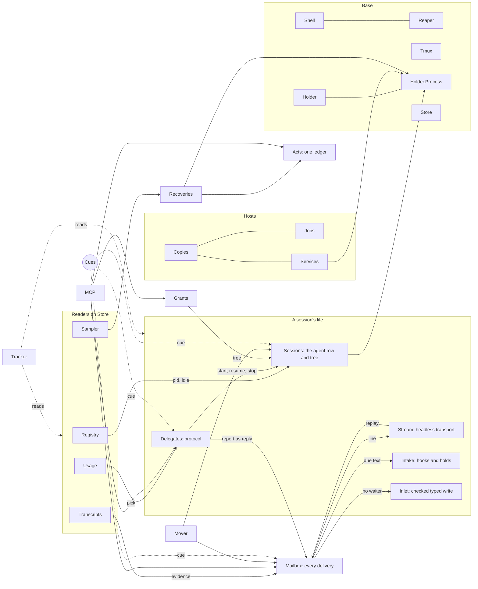

# F-115: an architecture review of the model and the code, and a proposed remodel

A review unit. It changes no code, no spec and no `docs/design.md`. It reads the model and every
app at `241c7e7` (F-113) against the design on `main` and F-114's design (unmerged, treated as
decided). It names where one mechanism was built more than once and where one fact is kept in
more than one place. It proposes a target shape and a path to it in units.

The aims, in order: fewer states that can disagree, more reliable outcomes, less code and less
model for the same behavior, and efficiency.

## What was read

- `docs/design.md` on `main`; F-114's `docs/design.md` and `docs/build-notes/F-114.md`.
- The nine specs in `model/tla/` (5,665 lines), their 175 configurations (138 of them
  `Break_*`), the 11 slow ones, `READING.md` and `bin/check-model`.
- The `lib/` and `mix.exs` of all 24 apps (16,577 lines), and enough of their tests (10,384
  lines) to see each contract.
- The `## Findings` of the build notes, F-1 to F-113.

Four readers went through the specs and three groups of apps in parallel. Each claim below was
read in the code; the main ones were checked again by hand. File references are
`apps/<app>/lib/coding_agent_framework/…` with the prefix dropped where the app is clear.

## What was measured

### Lines per part

| App | lib | test | | App | lib | test |
|---|---|---|---|---|---|---|
| caf_sessions | 1446 | 1065 | | caf_jobs | 596 | 387 |
| caf_mcp | 1193 | 1200 | | caf_registry | 572 | 241 |
| caf_services | 1176 | 551 | | caf_sampler | 558 | 195 |
| caf_stream | 1060 | 623 | | caf_recoveries | 549 | 261 |
| caf_delegates | 899 | 633 | | caf_shell | 530 | (in caf_test) |
| caf_tracker | 886 | 563 | | caf_grants | 465 | 328 |
| caf_test | 849 | 577 | | caf_mailbox | 433 | 333 |
| caf_intake | 825 | 328 | | caf_usage | 428 | 159 |
| caf_transcripts | 806 | 360 | | caf_cli | 416 | 282 |
| caf_copies | 732 | 430 | | caf_accounts | 312 | 148 |
| caf_example | 604 | 418 | | caf_screen | 284 | 180 |
| caf_tmux | 582 | 231 | | caf_holder | 237 | 209 |
| | | | | caf_control | 139 | 213 |

### Repeated code

| What | Copies | Lines, about |
|---|---|---|
| A table module over SQLite (`open/1` with WAL and a 5 s busy timeout, the schema) | 15 | 2,404 in all |
| `defp query(db, sql, args)`, prepare, bind, fetch, release, the same 11 lines | 15 | 165 |
| `rows_by_id/2` and its `?n` placeholders | 18 and 14 | 150 |
| An added column, its "duplicate column name" ignored | 6 apps, 3 variants | 60 |
| `update/3` with its `SET` builder; `select` zipped with `@columns` | 4; 12 | 100 |
| A `call/3` that turns `noproc`, timeout and exit into refused or unknown | 14 | 140 |
| A reader's loop: tick, read, diff against a cache, write with a reads row, cue | 4 (Registry, Usage, Transcripts, Sampler) | 400 |
| A `Tracker` source that opens a table and filters by host and account | 7 of 9 | 200 |
| `ps -o lstart= -p` and a pid file per held program | 6 and 3 | 120 |
| dtach's "Connection refused" probe outside `Holder` | 2 | 20 |
| `now/0` (three different clocks); `notify` default; `clock` default | 9; 11; 6 | 60 |

So about 1,800 lines of the 16,577 are the same few mechanisms written again: about a ninth.
F-37's new-3 asked for a shared SQLite helper; it was not built, and there are 15 copies now.

### Rows and their states

22 tables in 15 apps. Six of them keep state about one agent's session:

| Table (writer) | Status values | Of what |
|---|---|---|
| `held_sessions` (Sessions) | 7: starting, running, stopping, stopped, refused, unknown, orphan | the held process |
| `delegates` (Delegates) | 7: starting, resuming, running, finished, failed, refused, ended; `report` 4 (2 more planned) | the protocol |
| `stream_delegates` (Stream) | in a blob: message 3, request 5, line 2, flags idle, live_seen, gone, ending | the headless stream |
| `registry_sessions` (Registry) | `alive` 4: live, replaced, gone, unknown; Claude Code's own `status` | the session file |
| `transcripts_sessions` (Transcripts) | subagent 3; problem 3 | the transcript |
| `intake_events` (Intake) | `hold` 6: held, answering, answered, expired, lost, unknown | hook events |
| `messages` (Mailbox) | 4: queued, sending, delivered, ended | messages |

The rest: `claims` 4, `recoveries` 6, `mcp_calls` 3, `jobs` 8 (and `late` 3), `services` 7 (and
`fwd` 5), `copies` 6, `tmux_samples` 12 by kind. Rows that record an act cut by a restart use five
words for one idea: `interrupted` (Claims, Jobs, Sessions, Delegates), `cut` (MCP), `lost` and
`unknown` (Intake), `unknown{interrupted}` (Recoveries).

### The specs

| Spec | Lines | Breaks | Restart actions | Shares by `INSTANCE` |
|---|---|---|---|---|
| Shell | 265 | 4 | VM death | none |
| Move | 347 | 6 | none | none |
| Intake | 459 | 9 | yes | none |
| Agent | 598 | 9 | Recoveries only | none |
| Team | 654 | 26 | yes | none |
| Stream | 684 | 16 | yes | none |
| Delegate | 686 | 18 | yes | none |
| Start | 714 | 21 | yes | none |
| Copy | 1258 | 29 | yes | none |

No spec instances another. Six write their own framework restart, eight their own process, five
their own "turn ended", three their own "sending" mark settled from a transcript, and three their
own claim. The `UNCHANGED` frames are 5 to 19 % of each spec (235 lines in Copy).

### TLC on the fast configurations

`devenv shell -- bin/check-model`, all fast configurations, on the workstation under the load of
this review's readers (so the times run long; "fast" is meant to be under 30 s):

| Configuration | Generated | Distinct | Depth | Seconds |
|---|---|---|---|---|
| Agent_Claims | 246128 | 63240 | 32 | 33 |
| Agent_LateViewers | 44815 | 13206 | 30 | 20 |
| Agent_Viewers | 33713 | 11123 | 19 | 37 |
| Agent_Writes | 5662509 | 1199123 | 24 | 121 |
| Copy_Forward | 354969 | 119052 | 51 | 266 |
| Copy_Jobs | 25351 | 8675 | 22 | 46 |
| Copy_Services | 21327 | 7719 | 30 | 30 |
| Copy_Turns | 444967 | 138655 | 32 | 243 |
| Delegate_Answers | 86880 | 26345 | 32 | 37 |
| Delegate_Cap | 55631 | 17698 | 33 | 32 |
| Delegate_Design | 103718 | 36365 | 46 | 91 |
| Delegate_Restarts | 18592 | 6072 | 30 | 19 |
| Intake_Events | 70725 | 20844 | 23 | 33 |
| Intake_Holds | 105648 | 39074 | 24 | 48 |
| Intake_Tools | 2257 | 1026 | 13 | 11 |
| Move_Design | 311178 | 80970 | 32 | 37 |
| Shell_Design | 3775 | 1683 | 12 | 10 |
| Start_Restarts | 96448 | 35104 | 24 | 56 |
| Start_SharedTree | 172097 | 64083 | 32 | 115 |
| Start_TwoSessions | 697131 | 198724 | 24 | 507 |
| Start_Worktrees | 98914 | 34450 | 30 | 65 |
| Stream_Messages | 10499 | 4838 | 39 | 15 |
| Stream_Requests | 14748 | 6306 | 37 | 10 |
| Stream_Resume | 21166 | 9415 | 35 | 13 |
| Stream_Resumes | 15440 | 7393 | 37 | 15 |
| Team_Claims | 795061 | 148896 | 23 | 48 |
| Team_Delivery | 134137 | 27992 | 19 | 34 |
| Team_Faults | 2461577 | 477656 | 25 | 47 |
| Team_Messages | 4882305 | 904408 | 25 | 151 |
| Team_Operator | 874505 | 207188 | 21 | 54 |
| Team_OperatorClaims | 16049 | 4508 | 15 | 17 |
| Team_OperatorMessage | 25057 | 6268 | 15 | 32 |
| Team_OperatorServices | 71685 | 10116 | 15 | 27 |
| Team_Replies | 173909 | 37044 | 21 | 98 |
| Team_RepliesTwo | 3934521 | 752084 | 27 | 112 |
| Team_ServiceFaults | 218637 | 30492 | 19 | 36 |
| Team_Services | 667437 | 87672 | 19 | 69 |

All 37 pass, and each of the 138 `Break_*` configurations finds its bug. The 37 explore 4.8
million distinct states in 2,635 s, and the `Break_*` ones take 1,354 s more. 26 of the 37 took
longer than 30 s here, and `Start_TwoSessions` took 507 s. The machine was loaded, so these times
do not show whether a configuration is over its 30 s bound on its own (new-13). Team holds the
most states: 2.7 million of the 4.8 million.

## What was found

### 1. One mechanism built more than once

**a. Mark, act, settle from evidence.** Six implementations, sharing no code:

| Where | Mark | Act | Evidence that settles it | After a restart |
|---|---|---|---|---|
| Stream lines (`stream.ex:216-353`, `fold.ex:219-274`) | `marked`, `spooled` | spool, claim by `rm`, `cat` to the FIFO | the replay; the transcript at exit | claims again |
| Mailbox (`mailbox.ex:195-265`) | `sending` | `Stream.write` | Stream's fold (`Fold.outcome`) | queued again if Stream says none or undelivered |
| Delegates' brief and resume (`delegates.ex:441-459`, `turn.ex:81-90`) | the uuid in the row | `Stream.write` | Stream's fold | written again if none or undelivered |
| Delegates' report to a waiting call (`delegates.ex:291-325, 528-532`) | `answering` | MCP writes the answer | the caller's word and its process | held again |
| Intake's `PermissionRequest` (`intake.ex:195-351`, `table.ex:85-97`) | `answering` | the plug writes the response | the connection | `lost` or `unknown` |
| Sessions' stop (`sessions.ex:381-423, 586-597`) | `stopping` | `/exit` or `end_session` | pid and socket | settled by pid and socket |

Mailbox's `sending` mirrors Stream's message state for the same uuid: two marks for one write,
reconciled at each cue. The report's typed delivery that Delegates plans (`delegates.ex:141-146`)
would have been a seventh, and the waiter's an eighth. The common part is small and exact: a
row written before the act; refused undoes the mark, unknown keeps it; a later read of outside
evidence settles it, at a cue and after a restart. What differs is only the evidence and the
restart policy.

**b. Held hook requests.** Intake keeps two parallel structures: `holds` for `PermissionRequest`
and `tools` for `PreToolUse` (`intake.ex:170-171`), with two drop functions (`368-373`,
`392-397`), two `:DOWN` lookups (`325-351`), two response encoders (`377-390`, `407-424`) and two
deadline-and-margin pairs. The plug's wait (`plug.ex:90-110`) is already shared. F-114's waiter
and item 14's Stop held for an app callback would be the third and fourth copies. Two more holds
live outside Intake: Stream's `can_use_tool` requests (held, answering, answered, canceled,
lost), and `run_delegate`'s wait on a report in Delegates and MCP (`mcp.ex:392-413, 493-513`),
which is a held request whose answer is a report. All are one shape: a request held open with a
deadline, answered exactly once by a named decider, and settled when the holder dies.

**c. Rows that record acts.** `recoveries` and `claims` are one rule twice: a row written before
the act, keyed by the state, and a state once claimed stays claimed whatever the end. The design
says so ("the way `Recoveries` acts once per state"), and `claims.ex:16-17` names Recoveries'
states, yet Recoveries does not use Claims. They differ by accident: Recoveries has no actor, no
`start_id` and no Grants check; Claims has no cue and no unique index (it scans every row,
`claims.ex:171-177`). F-114's design adds a third (a forward reopened once per state) and item 14
a fourth (the fault ledger). MCP's call log and Intake's decision rows are the same "written
before, settled after" shape with their own restart words.

**d. Held processes.** `Holder` knows sockets only. Each caller builds its own record of a held
program (pid, start time, socket, deadlines) and its own end and settle: Sessions interactive
(through Registry), Sessions headless (its own `@held` script, `sessions.ex:133-139`), Jobs (its
own copy of Holder's probe, `jobs.ex:86-95`), Services (`services.ex:78-133, 583-598, 727-778`)
and its forward (`services.ex:94-110, 681-722`). `ps -o lstart=` is in six places and
`dead in [:absent, :stale]` in six. `Copies.Held` (F-84) shares the start between Jobs and
Services only. Recoveries' end of an orphan "by the row's pid and start time" is in the design
but not built (no signal in `caf_recoveries/lib`); it would be a seventh.

**e. Readers.** Registry, Usage, Transcripts and the sampler repeat one loop (above). Usage
already runs as one process over every account (`usage.ex:161`); Registry and Transcripts run
one per account. Registry's table is keyed by `(host, account, file)` already, so the unit-13
"found through `Registry` across every account" is a change of how it is started, not of what it
stores.

**f. Ways into a session.** Today: Stream lines into a headless delegate, and `Control.send`,
used only for `/exit` (`sessions.ex:423`); `Control.interrupt/stop/respawn` have no caller, and
nothing calls `Screen.read`. F-114 adds the waiter and keeps a checked typed write for a session
with no waiter. So after F-114 there are three inlets (stream line, waiter, typed write) and one
outlet question for each: did it go in, read from evidence. That is one mechanism (1a) with three
transports, not three mechanisms.

### 2. One fact kept in more than one place

| Fact | Places | Truth | Can the others be derived? |
|---|---|---|---|
| Whether a delegate's process lives and its life status | `held_sessions.status`; `delegates.status`; Stream's `gone`; Registry's `alive` | Sessions' row, by pid, start time and socket | Delegates' running, refused and ended, yes (from Sessions and the report). Stream's `gone` is the stream's own reading of its socket and decides exits a second time (`stream.ex:271-278` beside `sessions.ex:606-629`). |
| Which agents are in the tree, and who is a main session | `Grants`' tree from `example.ex:302-305` (declared mains plus `Delegates.Table.with_status`); `Tracker.Tree` (`tree.ex:50-53`, mains as parents that are not delegates) | neither: there is no agents table | Yes, from one table. The two rules differ today (F-99's new-3): a declared main with no delegate is in Grants' tree and not in `agents()`. |
| Which delegate statuses hold an agent | `delegates/table.ex:40`, `mailbox.ex:48` (adds `refused`), `tracker/tree.ex:30`, `example.ex:53`; "ended" in `sessions.ex:141`, `sessions/table.ex:42`, `delegates.ex:481`, `example.ex:55` | Delegates | Yes: one function in the owning part. |
| A message's delivery state | `messages.status`; Stream's `messages[uuid].state` | Stream's fold for a delegate | Yes: Mailbox's `sending` is a copy of Stream's state. |
| A delegate's report | `delegates.report` and `text`; the reply rows in `messages` are already "a delegate's result stored as a message to its parent" | — | Yes: a report is the reply to the brief. Delegates already marks it with the brief's uuid, and Mailbox stores every later reply under the uuid it answers (F-79). |
| Whether a turn has ended | Stream's `idle`; Mailbox's `ready?`; Tracker's state; Delegates' `Fold.outcome` and `ends_with_reply`; Sessions' caller's word (`sessions.ex:385`); Registry's `status` (read by nothing); Screen's `:idle` (called by nothing); Intake's Stop rows (read by nothing) | Stream for a headless delegate; after F-114, the session file's `idle` and the waiter for a main session | Yes: one function per kind of session, in the part that owns that session. |
| A held program's pid and start | Sessions' row (from Registry or the pid file); Registry's row; Services' row | the row of the part that holds it | Registry's copy is evidence, not state: fine. |
| The stream directory's layout (`pid`, `events.jsonl`) | ClaudeCLI, Stream, Sessions | ClaudeCLI writes it | One module should name the paths. |

The joins between these live outside the parts that own them: Mailbox opens `Delegates.Table`
(`mailbox.ex:101`), Delegates opens `Sessions.Table` (`delegates.ex:196`), and the embedding app
opens both (`example.ex:69-70`) to build the tree, find a worktree (`place/1`) and name an agent
for Intake (`agent_of/1`). A status renamed in one app breaks three others at run time, not at
compile time.

**The cue graph is in the app.** `example.ex:43-51` routes each reader's cue to the parts that
must settle on it ("stream" to Sessions, Delegates and Mailbox, and so on). That table is the
order in which the system settles, and it is not in the library, the model or the design's parts
table. An app that wires it differently gets a framework that settles late or never. Jobs and
Services have no `notify:` at all and are driven by a ticker with a fake topic.

### 3. The specs

**Duplicated across specs** (each line is one concept, then where it is written):

- a framework restart: Intake, Delegate, Start, Stream, Team, Copy (six encodings);
- a session's process: Move `procs`, Delegate `proc` and `parentRuns`, Team `proc` and `epoch`,
  Stream `alive`, Start `proc`, Agent `procs`;
- the turn ended: Move `turn = 0`, Delegate `~turn`, Team `proc = "idle"`, Stream `turn`/`idle`;
- the sending mark settled from a transcript: Delegate `report = "sending"` with `got`, Team
  `msgs.st = "sending"` with `inbox`, Stream `msg = "writing"` with `heard`;
- a claim before an act: Agent `claimed`/`acting`, Team `claims`/`calls`/`done`, Copy
  `frow = "reopening"`/`facting`, each with its own "claim in memory" Break;
- a held request answered once: Intake `hold`, Stream `hold`, Delegate `report` answering;
- a call cut by a restart and settled from the other side's row: Delegate `Settled`, Start
  `Adopt`/`ReRead`, Copy `SettleStarting`, Stream `HeldTold`.

**What F-114 replaced and the specs still model:** Delegate's `DeliveryTyped` and its strong
fairness, through "Control's checked write" (`Delegate.tla:36-41, 420-458, 594`); Team's
`DeliveryTyped` (`Team.tla:31-32, 335-345`) and its stop "as the /exit of Move.tla"
(`Team.tla:94`); Move's end typed through Control with the box empty (`Move.tla:22-24, 226-235`);
Start's `StopAsked` (`Start.tla:527`). Delegate's `SendingResolved` settles at once, where F-114
settles "once the parent's turn that took it has ended": with the waiter there is a gap between
the waiter's answer and the line in the transcript, which no spec has.

**What the code relies on and no spec checks:**

1. A message or a report in flight during a move across accounts (known). Move has no Mailbox,
   no restart, and no settle against the copied transcript; Delegate's `got` knows one
   transcript.
2. The waiter: one per session, due text held until one connects, answered at most once, its
   timeout, a restart that cuts it, and the typed write when there is none.
3. A report and a reply keyed by uuid across a resume. Stream sets `report = "ready"` on any
   result; Team keys a reply by message with no resume; Delegate gives a resumed message a new
   uuid while Stream resends under the same one. No spec has the brief, a resume and a message
   together.
4. Mailbox's order with a resume. Team's `InOrder` is per sender and addressee with no resend;
   Stream orders every message to the delegate in one order and resends the undelivered first.
   The two orders differ and are not checked together.
5. Who may answer a dialog. Intake says "the agent's claim is Team.tla's"; Team's fixes are only
   interrupt, resume and stop and it defers to Intake. Each defers to the other.
6. The operator answering dialogs or moving a session; launch narrowing across a resume; the
   fault ledger; Move with a restart of the framework; Stream's claim ended by `Recoveries`.

**Should they compose?** Yes, partly. One spec of a session's whole life checked in one run
would not finish. But three small modules would remove most of the repetition: a `Claim` module
(a durable claim on a target's state, acted on only while current, cut by a restart), a `Hold`
module (a held request answered once by its named decider, re-held or unknown after a restart),
and a `Delivery` spec that owns the mark and settle of 1a with the transport left as a choice.
Agent, Team and Copy would instance `Claim`; Intake, Stream and the new `Delivery` would instance
`Hold`; Delegate, Team and Move would read `Delivery`'s state instead of writing their own
`got`, `inbox` and `transcript`.

### 4. Parts that no longer earn their place, or cut one concern in two

- **Control** (139 lines): after F-114 its only use, `/exit`, goes; the typed write that stays
  for a session with no waiter needs `Screen`'s box check and the same tmux one-command check.
  `Control` and `Screen` are one concern, "a checked typed write into a main session", cut in
  two. Viewers (`open`, `resize`) are `Sessions`' and `Recoveries`' use of `Tmux`.
- **Delegates and Sessions**: a delegate's life is in both tables and Delegates reads Sessions'
  table behind its API. Delegates' own facts are few: its parent, branch and cap, its resume
  count, its brief's uuid and whether its report was taken.
- **Mailbox and Delegates**: a report and a reply are one thing (a delegate's result to its
  parent), stored in two parts with two delivery plans.
- **Recoveries and Grants' claims**: one rule in two tables (1c).
- **Copies.Held** lives in `caf_copies` because Jobs and Services needed it first; the held
  process record belongs beside `Holder`.
- **MCP** (850 lines in `mcp.ex`): its size is 205 lines of tool schemas and one `act` clause per
  tool; its real logic is about 150 lines. It checks `Grants` twice for a message (here and in
  Mailbox) and twice for a fix (here and in Claims). It earns its place; it does not need to
  grow.
- **Tracker sources**: seven of nine are one 30-line module. They earn their place as data,
  not as modules.
- **`Tmux.Fake`** ships in `caf_tmux/lib`; it is a test aid.

What earns its place as it is: Shell and its reaper, Tmux's one-command check, Holder, Stream's
transport, Copies and Jobs, Grants' checks, Screen as a pure reading, Usage's reading rules,
Transcripts' fold, ClaudeCLI and Accounts.

### 5. What the accepted next units would bolt on

On today's shape:

- **Item 13, delivery by the waiter**: a third hold structure in Intake; a seventh mark-and-settle
  in Delegates (`sending`, `delivered` on the report) beside Mailbox's for main sessions (an
  eighth); a fourth list of delegate statuses; a new transcript settle (`Transcripts.contains/6`
  waits for this, uncalled). The typed write would be a new mechanism in Control over Screen.
- **The end by SIGTERM**: a sixth `ps -o lstart=` and a second "signal by pid and start time"
  beside Services', since Recoveries' kill is not built.
- **Mains (item 6)**: a third tree rule, unless the tree gets a table.
- **Mover (item 5)**: Move's state (`record`, `phase`) as a new table, with delivery during a
  move checked nowhere.
- **Item 14**: "idle with no report" as a fifth reading of the turn; Stop held for an app
  callback as the fourth hold; the fault ledger as a third claims-like table plus a subscription
  every part must call; a start idempotent per branch as one more join of Delegates' and
  Sessions' tables.

On the shape below each of these is a few lines in one part: a new hold kind, a new transport of
one delivery, a row kind, a query, an act kind.

## What is proposed

### The target parts

Each part one job, one writer of its table. New or changed parts are in **bold**.

| Part | Job | Owns |
|---|---|---|
| Shell, Reaper, Programs, Hosts | as today | — |
| Tmux, Holder | as today | — |
| **Holder.Process** (in `caf_holder`) | a held program's record: pid, start time, socket; read in one batch; end by TERM then KILL by pid and start time; "dead" as pid gone and socket absent or stale | no table; a value each owner keeps on its row |
| **Store** (`caf_store`) | open, schema, added columns, `query`, `rows_by_id`, `update`, upsert, a reads row, load with defaults | no table |
| **Reader** (a shared module beside Store) | the loop: read on an interval or a call, diff, write, cue; a `Tracker` source made from its table | each reader its table |
| Registry, Usage, Transcripts, Sampler | as today, on Reader; **one Registry and one Transcripts per host over every account** | their tables |
| Sessions | **the agent row**: one row per agent, main or delegate, with its kind, parent, project, account, options, process and status; start, resume, stop by SIGTERM after `idle`; the tree as a function of its rows; the turn state of each session from its evidence | `agents` (today's `held_sessions` with the tree's columns) |
| Delegates | the delegate protocol only: checks, cap, account pick, resume once, a second kill; it hands the report to Mailbox as the reply to the brief | `delegates`, reduced to its own facts: branch, brief uuid, resumes, taken |
| Stream | a headless session's transport: FIFO per process, spool claim, event log from an offset, requests | `stream_delegates` |
| **Intake** | hook events in; **one hold structure** with kinds `permission`, `tool`, `stop` (the app's callback) and `waiter` | `intake_events` |
| **Inlet** (Control and Screen merged) | a checked typed write into a main session with no waiter: Screen's box check and Tmux's one-command check | no table |
| **Mailbox** | **every delivery**: messages, replies, notices, reports, the app's word; one mark and settle; the transport chosen by the target: a Stream line, the waiter, the typed write, or the answer of a waiting `run_delegate` | `messages` |
| **Acts** (Claims and Recoveries' rows merged) | one ledger: an actor's act on a target's state, written before, once per state, settled after, cut by a restart; with a cue; the fault ledger is a query of it | `acts` |
| Recoveries | detect a broken state, take an act in Acts, act, verify; ends an orphan by `Holder.Process` | no table of its own |
| Grants | the checks, over Sessions' tree | — |
| Copies, Jobs, Services | as today, the held record through `Holder.Process`; Services' forward as a second held record of the service | their tables |
| Mover | the move, against `Move.tla` | its phase on the agent row |
| MCP | the tools, checked once | `mcp_tokens`, `mcp_calls` |
| Tracker | the fold of every reader; its sources from table metadata | — |
| **Cues** | the reads each part declares; the app starts one per instance and stops routing by hand | — |

What a part reads it reads through the owning part's functions, never by opening another part's
table. A status list lives once, in its owner.

### How the flows go through it

**A session's life.** Sessions writes the agent row first (`starting`), holds the program, and
settles it by `Holder.Process` and the session file or the stream's init: `running`. Its turn
state is one function per kind: a headless session's from Stream's fold, an interactive one's
from the session file's `status` and Intake's waiter. Its end is SIGTERM after `idle` (or
`end_session` for a headless one), and it is `stopped` once the process is gone and the socket
dead. Recoveries ends an orphan by the same record, under an act in Acts. A move is a phase on
the same row.

**A delivery.** Anything for an agent is a row in Mailbox: a message, a reply, a notice, the
app's word, and a report (the reply to the brief's uuid). Mailbox picks the oldest due row per
addressee, marks it `sending` with its transport, and hands it on:

- a headless session: a Stream line under the row's uuid; settled by the replay, or by the
  transcript at the exit;
- an interactive session with a waiter: the waiter's answer; settled by the transcript's
  `Stop hook blocking error` line once the turn that took it has ended;
- an interactive session with no waiter: the Inlet's checked write; settled the same way;
- a waiting `run_delegate`: the call's answer; settled by the caller's word and its process
  (today's `answering` rule, F-92 to F-97).

Refused undoes the mark; unknown keeps it for the evidence. After a restart, every `sending` row
settles from the same evidence. The row is the only mark: Stream keeps its line claim (that is
transport, not delivery) but no message state of its own; Delegates keeps no report delivery
state.

**A hook.** Intake writes the event, then answers, as today. A hook that waits is a hold: a key,
a deadline under the hook's timeout, a named decider (a person or an agent through `answer`,
the app's callback, or Mailbox's due text), exactly one response, and a settle when the holder
or its connection dies (`lost` or `unknown` for a row-backed hold, nothing for the others). The
four kinds differ only in their decider, deadline and response encoder.

**An act.** Every fix, recovery, kill, resume, start and raised error is a row in Acts:
`{actor, target, state, act, start_id, status, outcome}`, written before it acts, refused for a
state already acted on, `interrupted` when a restart cut it. MCP's fixes, the operator's acts
and Recoveries take it the same way. The fault ledger of item 14 is a query and a cue topic.

### The model that goes with it

| Spec | What becomes of it | What it checks |
|---|---|---|
| Shell | kept as it is | as today |
| Agent | kept; `Claim` instanced for Recoveries; the comments that say `/exit` go | as today |
| Start | kept; `StopAsked` by SIGTERM after `idle`; Recoveries' kill by pid and start time is the same `KillsOwnOnly` | as today |
| Copy | kept; `Claim` instanced for the forward's reopen. Optionally split the forward (about 230 lines) into its own spec when it next changes | as today |
| **Claim** (new, about 60 lines) | the claim before an act, once per state, cut by a restart | `OneClaimPerState`, `OneActPerState`, `NoActOnCutOffClaim` |
| **Hold** (new, about 80 lines) | a held request answered once by its decider, its deadline, its holder's death, a restart | `OneResponse`, `LateDropped`, `OnlyNamed`, `RequestsEnd` |
| Intake | the events half kept; the holds become four `Hold` instances: permission, tool, stop, waiter | as today, and one waiter per session, due text held while none waits |
| **Delivery** (new, about 450 lines) | Mailbox's one mark and settle, over transports stream, waiter, typed and call; restarts; a resume; a move across accounts | at most once, only into an ended turn or to the current process, in order per sender and addressee, a reply or a notice once, a report is the reply to the brief, settled against the copied transcript after a move |
| Stream | its transport kept (offset, spool, FIFO per process, requests); its `msg` becomes the evidence `Delivery` reads | as today, less `IntoEndedTurn` and `ReplayedOrFound`, which move to Delivery |
| Delegate | shrinks to the protocol: rows first, cap, resume once, a second kill, the report handed to Mailbox; `DeliveryTyped` and the report's `sending` go | the start and resume properties; `ReportArrives` through Delivery |
| Team | shrinks to Grants, the operator and services' owners; claims by `Claim`; messages by `Delivery` | edges, who fixes, owners |
| Move | rewritten: the end by SIGTERM after `idle`; a framework restart; `Delivery`'s waiter across the move | as today, plus nothing delivered to the old process and once to the new |

Each is checked on its own; a cross-spec gap (a move with a message in flight) is checked in
the spec that owns it (`Move` with `Delivery`'s state), not by composing everything in one run.
The total stays about the same size, about 5,400 lines, but each mechanism is written once, and
the unchecked properties of section 3 get a home.

`model/tla/slow/Intake_Large.cfg` sets no `MaxCalls`, which `Intake.tla:55` declares since F-111
(new-1 below). `Stack.tla`, spec 5 of "The model", is not written; it waits for unit 17.

### The path, as units in order

Each keeps every gate green at its end. Sizes are changed lines apart from fixtures, estimated.

| # | Unit | Size | Removes | Replaces or reorders |
|---|---|---|---|---|
| R1 | **`caf_store`**, and the writers' tables on it (Sessions, Delegates, Stream, Mailbox, Intake, Jobs, Services, Copies, MCP, Claims, Recoveries) | +250, −700 | 11 copies of open, query, migrate, update, select | new; F-37's new-3 |
| R2 | **Reader** on `caf_store`: Registry, Usage, Transcripts, Sampler; Tracker sources from table metadata; one Registry and one Transcripts per host over every account | +200, −650 | the reader loop ×4, seven sources | takes item 13's "found through Registry across every account" |
| R3 | **`Holder.Process`**: Sessions, Jobs, Services and the forward on it; Recoveries' end of an orphan and of a late stop | +200, −300 | six `lstart` reads, three pid files' parsers | builds the unbuilt kill of "The parts" table |
| R4 | **Model**: `Claim.tla` and `Hold.tla`; Agent, Team, Copy and Intake instance them; the `/exit` text goes; `Intake_Large` gets `MaxCalls` | specs only, about −300 net | three claim encodings, two hold encodings | none; before R5 and R7 |
| R5 | **Intake's one hold**: `holds` and `tools` become one structure; then the `waiter` kind (F-114) | +250, −120 | the parallel copies | item 13's waiter, its Intake half |
| R6 | **Model**: `Delivery.tla`; Delegate, Team and Stream read it; Move rewritten with SIGTERM, a restart and a move with a message in flight | specs only, about +450, −500 | three sending marks, typed delivery | item 13's "modeled first", and its move check |
| R7 | **Mailbox delivers everything**: the report as the reply to the brief; transports stream, waiter, call; Mailbox's `sending` as the only mark; Delegates' `report` reduced to `taken` | +350, −350 | Delegates' delivery plan, the mirror of Stream's state | item 4 and item 13's delivery and `run_delegate` |
| R8 | **Inlet**: Control and Screen's typed write for a session with no waiter, as one more transport | +200, −140 | Control | item 13's checked write |
| R9 | **The agent row and the tree**: Sessions' row takes kind, parent and project; the tree is one function there; Grants, Tracker, Mailbox and the app read it; no part opens another's table | +300, −350 | two tree rules, four status lists, three cross-table reads, the app's `tree`, `place` and `agent_of` | most of item 6 (`Mains`: a main session is a row of kind `main`) |
| R10 | **Acts**: Claims' and Recoveries' rows in one table with a cue | +250, −300 | one of two claim tables | item 14's fault ledger |
| R11 | **Cues**: each part declares the topics it reads; Jobs and Services cue; the app's routing table and ticker go | +200, −200 | `example.ex`'s `@routes`, `Ticker`, fake topics | new; F-102's new-3 |
| R12 | **Mover**, on the agent row and Delivery | as planned | — | item 5 |

Then the rest of item 13 (interactive delegates, `Mains`' kept services) and item 14 on this
shape: idle with no report is a value of the turn function; admission is a check in Delegates
and Jobs; Stop held for the app's callback is a hold kind; a start idempotent per branch is a
lookup of the agent row.

R1 to R3 change no behavior and can go first, in any order. R4 and R6 are the model before the
code they describe (R5, R7 to R10). About 3,100 lines change in all; the library ends about
1,300 lines smaller, and the model about the same size with each mechanism once.

### What stays exactly as it is, and why

- **Shell, the reaper and `Shell.tla`**: one job, checked, and every rule in "dtach" holds.
- **Tmux's one-command check and `Agent.tla`'s writes**: the typed write that stays needs it as
  it is.
- **Stream's transport**: a FIFO per process, a spool removed as the claim, a line within the
  pipe's atomic size. It is the reason a line is never written twice or cut; only its message
  state moves to Mailbox.
- **Start's rules and `Start.tla`**: the row first, adoption at the start's deadline, a stop done
  only when the pid is gone and the socket dead. `Holder.Process` is these rules as a module.
- **Copies, Jobs, the fetch and `Copy.tla`**: one domain with its own protocol, already shared
  through `Copies.Held`; nothing else repeats it.
- **Grants' checks**: pure, small, right. Only the tree they read moves.
- **Screen as a pure reading per release**, Usage's reading rules, Transcripts' fold,
  ClaudeCLI and Accounts.
- **Each part its own app and the layers one way**: the remodel adds two apps (`caf_store`,
  `Cues` if it is its own) and removes one (`caf_control` into the Inlet).

### What it costs and what it buys

It costs about twelve units, about 3,100 changed lines and three spec rewrites, while units 4 to
6 and 13 wait. R6 and R7 change the delivery every agent depends on, and they are the riskiest:
Mailbox's `sending` as the only mark must keep Stream's guarantee that "undelivered" is final and
resent first under the same uuid. `INSTANCE` can make TLC slower than inlined actions; each
instanced spec's state counts are compared before and after. Tests move with their code: about
2,000 of the 10,384 test lines.

It buys:

- one mark and settle, one hold, one claim, one held-process record and one reader loop, each
  written and modeled once;
- the unchecked properties of section 3 checked, the move with a message in flight among them;
- no status list, tree rule or turn reading in more than one part, so a rename fails at compile
  time in one place;
- the accepted units smaller than they would be on today's shape (above);
- the app's wiring down to configuration.

Where today's shape is right (base, hosts, Stream's transport, Start), nothing moves. If only
part of this is taken, take R1 to R3 (no behavior change, about −1,200 lines) and R5 to R7
(they are item 13's work done once instead of again).

## Findings

### new-1. `slow/Intake_Large.cfg` sets no `MaxCalls`

What happened: `Intake.tla` declares `MaxCalls` since F-111; every fast Intake configuration sets
it, the slow one does not. TLC stops on a constant left unset, so this configuration cannot run.
Why: F-111 added the constant and ran the fast configurations, which the gate runs; the slow ones
run by hand.
What I did: nothing; this unit changes no spec.
What the design should change: `bin/check-model` parses the slow configurations in the gate
(TLC's parse alone, without the search), so a constant left unset fails there.

### new-2. Mailbox's `sending` and Stream's message state are two marks for one write

What happened: Mailbox marks a row `sending`, then Stream marks the same uuid `writing`; Mailbox
settles by reading Stream's state at each cue (`mailbox.ex:195-201`). After a restart the two
are reconciled in an order the example's cue routing sets.
Why: Stream's message state was built (F-34, F-51) before Mailbox (F-77), and Mailbox was
fitted on top.
What I did: nothing.
What the design should change: one mark, in Mailbox; Stream keeps its line claim only (R7).

### new-3. A report and a reply are one thing with two delivery plans

What happened: a reply is a delegate's result stored in Mailbox as a message to its parent
(F-79); a report is a delegate's result held in Delegates' row with its own planned `sending`
and `delivered` (`delegates/table.ex:11-14`, `delegates.ex:141-146`).
Why: the report came first (F-14, F-59); replies were added later beside it.
What the design should change: the report is the reply to the brief's uuid, stored and delivered
by Mailbox; `run_delegate` is one transport of it (R7).

### new-4. Recoveries' rows and Grants' claims are one rule in two tables

What happened: both write a row keyed by a state before an act and refuse a second one; they
differ in actor, `start_id`, cue and index by accident (`recoveries/table.ex:61-94`,
`claims.ex:105-132, 171-177`). Claims has no unique index and scans every row per claim.
What the design should change: one `Acts` table, which is also item 14's fault ledger (R10).

### new-5. Intake's two holds would become four

What happened: `PermissionRequest` and `PreToolUse` each have their own map, drop, `:DOWN`
lookup, encoder and deadline (`intake.ex:170-171, 325-424`). F-114's waiter and item 14's Stop
callback would add two more.
What the design should change: one hold with four kinds, modeled once as `Hold.tla` (R4, R5).

### new-6. The held-process record is built in six places, and Recoveries' kill is not built

What happened: `ps -o lstart=` and a pid file are read in Sessions, Services (four scripts),
the forward and Registry; Jobs repeats Holder's probe. The design's `Recoveries` ends an orphan
by pid and start time; no code does.
What the design should change: `Holder.Process` beside `Holder` (R3).

### new-7. The tree has two rules and no table

What happened: `Grants`' tree is the app's declared mains plus `Delegates.Table.with_status`
(`example.ex:302-305`); `Tracker.Tree` takes mains as parents that are not delegates
(`tree.ex:50-53`). The list of statuses that hold an agent is in four apps. Mailbox, Delegates
and the app open other parts' tables to join them.
What the design should change: the agent row in Sessions with kind and parent, the tree one
function of it, and no part opening another's table (R9). `Mains` then adds rows, not a rule.

### new-8. The order in which the system settles is in the embedding app

What happened: `example.ex:43-51` routes each cue to the parts that settle on it; Jobs and
Services have no `notify:` and a ticker sends them a fake topic. An app that wires it otherwise
settles late or never, and no spec or test of the library sees it.
What the design should change: each part declares what it reads; the library's `Cues` routes
(R11).

### new-9. Six specs each write a restart, three a claim, three a sending mark

What happened: no spec instances another; the same idea has a different encoding and its own
Break in each (section 3). At least five properties the code relies on have no spec, among them the known
message in flight during a move, the waiter, and a report against a reply across a resume.
What the design should change: `Claim`, `Hold` and `Delivery` as modules the others instance or
read (R4, R6), each checked on its own.

### new-10. `Control` and `Screen` are one concern cut in two

What happened: after F-114 `Control.send` keeps no caller but `/exit`, which goes; the typed
write that stays needs `Screen`'s box check and Tmux's checked write together.
What the design should change: one Inlet part, a transport of Mailbox (R8).

### new-11. Seven readings of "the turn has ended"

What happened: Stream's `idle`, Mailbox's `ready?`, the Tracker's state, Delegates' outcome and
transcript reading, Sessions' caller's word, and three readings nothing calls (Registry's
`status`, `Screen`'s `:idle`, Intake's Stop rows).
What the design should change: one function per kind of session in Sessions, which F-114's
`idle` read and the waiter then feed (R9).

### new-12. `Tmux.Fake` ships in the library

What happened: `caf_tmux/lib/…/tmux/fake.ex` is a test double, compiled into the package.
What the design should change: it moves to `caf_tmux`'s `test/support`, or to `caf_test` once
`caf_test` may use `caf_tmux` (F-42's new-1).

### new-13. The fast configurations' 30 s bound is not measured on an idle machine

What happened: under this review's load, 26 of the 37 fast configurations took longer than
30 s, and `Start_TwoSessions` took 507 s. `bin/check-model` prints the times but checks no bound.
Why: the bound is a note in the script's header. No gate checks it.
What I did: recorded the times above.
What the design should change: the next unit that changes a spec times the fast set on an idle
machine. A configuration over its bound moves to `slow/`, or gets smaller bounds.
